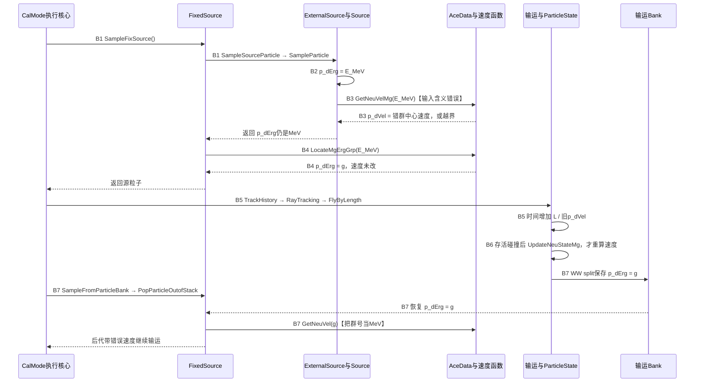
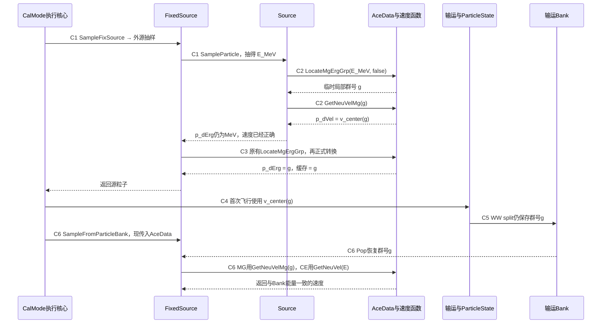
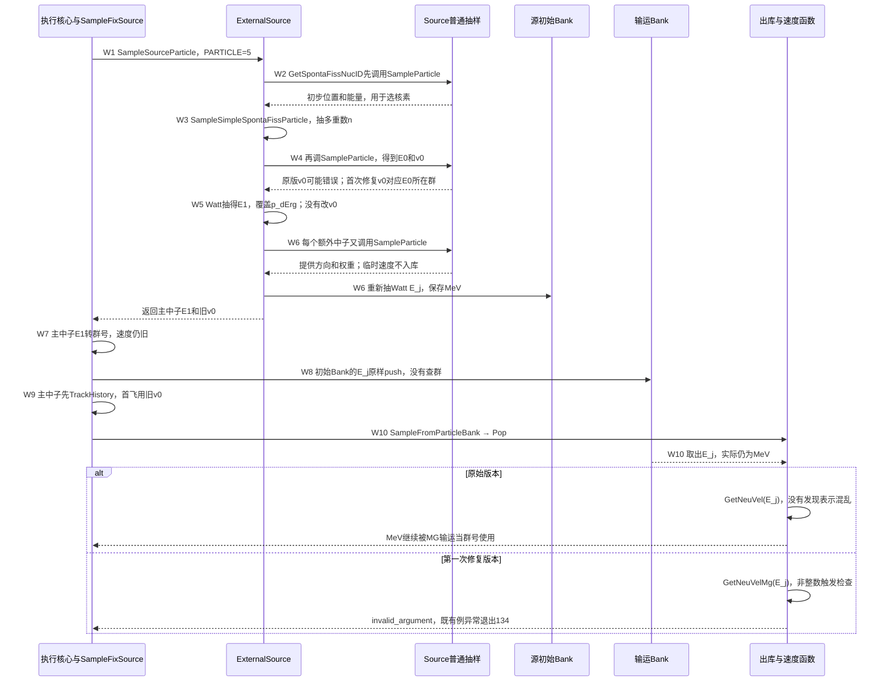
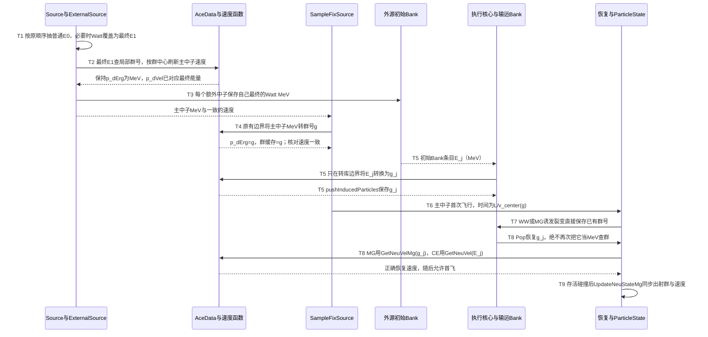

# W14 多群源速度问题：顺着源码读懂三种时序

> 只读源码理解报告 · 2026-10-17。面向人工对照源码阅读；本轮没有修改 RMC、编译、运行输运或提交。正文中的“目标”均为待实现的修复逻辑。
>
> 配套 [HTML 阅读版](01_源码理解报告.html) 提供目录跳转、内嵌 SVG 离线时序图和折叠代码；图与本 Markdown 的 Mermaid 步骤一致，HTML 不依赖联网加载 Mermaid。

这份报告围绕三个具体断点展开：**普通源过早把 MeV 送入群号函数；Watt 谱在速度算完以后再次换能量；自发裂变额外中子的 MeV 又未经转换进入了按群号恢复的输运库。** 按图中的步骤编号往下读，每一步都能回到实际函数。

## 阅读导航与版本约定

- [A. 变量、群号和两种 Bank](#a-variables)
- [B. 原始普通源与 WW 后代时序](#b-original)
- [C. 第一次修复，以及 Watt 分支为什么失败](#c-first-fix)
- [D. 完整正确修复的目标时序](#d-target)
- [E. 源码定位表](#e-locator)
- [F. 三个版本的差异对照](#f-compare)
- [G. 用直白的话收束这条因果链](#g-summary)
- [附录：版本身份与证据](#appendix)

| 名称             | 本文实际使用的版本                                        | 定位方式                                                                      |
| ---------------- | --------------------------------------------------------- | ----------------------------------------------------------------------------- |
| 原始版本         | RMC 冻结提交 `4810694b7a99dfc3ad7d27f7d443814f511f4829` | 用 `git show` 读取；没有 checkout                                           |
| 第一次修复版本   | 相同 HEAD 上现有的 8 文件未提交修改                       | 当前 `RMC/src/`；8 文件 SHA256 全部等于首次修复档案，完整 diff 也逐字节相同 |
| 完整正确修复目标 | **尚未实现**的状态流约束                            | D 节标明现有插入位置，示意代码不构成已应用补丁                                |

原始源码行号明确标注“原始”；其余行号属于本轮核对的当前工作树。未改文件（如 `ExternalSource.cpp`）两版行号一致。查看原始行号的安全命令，例如：

```bash
git -C RMC show 4810694b:src/SampleParticle.cpp | nl -ba | sed -n '76,93p'
nl -ba RMC/src/SampleParticle.cpp | sed -n '76,96p'
```

源码链接旁的行号是定位依据；浏览器未必支持源码文件的 `#L` 行锚点，可在编辑器按行号跳转，或用上面的只读命令查看。

证据标签：**SOURCE VERIFIED** 表示本轮从指定版本源码逐句核对；**INFERRED** 表示由源码推导的后果或目标方案；**UNVERIFIED** 表示没有覆盖的运行/物理输出。引用既有动态观察时另写“既有动态证据”，不伪称本轮重跑。

<a id="a-variables"></a>

## A. 先把变量和物理量分开

### A.1 同一个 `double`，前后可能装的是两种东西

| 对象                        | 应该怎样理解                                                                                         | 什么时候改变                                                                           |
| --------------------------- | ---------------------------------------------------------------------------------------------------- | -------------------------------------------------------------------------------------- |
| `CDSource::p_dEnergy`     | 源抽样得到的**物理动能，MeV**。固定能量直接给值；能谱分布会改写它                              | `SampleVariableFromDistri()` 抽 ENERGY 分布后                                        |
| `CDParticleState::p_dErg` | 一个复用的存储槽。普通源刚抽完时装 MeV；MG 中子开始输运时应装内部群号 `g`，虽然类型仍是 `double` | `SampleParticle()` 写入 MeV；Watt 会再写一次 MeV；`SampleFixSource()` 才覆盖为群号 |
| 内部多群群号 `g`          | 无量纲整数 `1…G`，**1 为最高能群，G 为最低能群**                                            | 由 MeV 查群边界得到；碰撞后可抽得新的出射群                                            |
| `p_vNeuMltCentErg[k]`     | 第 `k` 个群中心的物理能量，MeV；此向量按**低能到高能**存放                                   | 核数据初始化时填充；`k=G-g`，合法下标 `0…G-1`                                     |
| `p_dVel`                  | 与当前输运能量对应的速度，单位 **cm/shake**，`1 shake=10^-8 s`                               | 必须在最终能量确定或改变后显式赋值；改 `p_dErg` 不会自动更新它                       |
| `p_nMultiGrpNumber`       | 另一个整数群号缓存，不是 MeV，也不是速度                                                             | 普通源转换和 `UpdateNeuStateMg()` 会更新；当前 Bank 恢复未更新，见 C.7 的独立限制    |
| `p_dExitErg`              | 碰撞过程的出射能量槽；MG 标准裂变分支放出射群号，CE 放 MeV                                           | `GetMgFisErgDir()` 或 CE 反应抽样；随后被复制至粒子或 Bank                           |

**SOURCE VERIFIED**：变量定义见 [ParticleState.h:452](../../RMC/src/ParticleState.h#L452)、[468](../../RMC/src/ParticleState.h#L468)、[509](../../RMC/src/ParticleState.h#L509)、[1183](../../RMC/src/ParticleState.h#L1183)。源 ENERGY 分布赋值见 [SampleVariableFromDistri.cpp:101–104](../../RMC/src/SampleVariableFromDistri.cpp#L101) 与 [220–223](../../RMC/src/SampleVariableFromDistri.cpp#L220)。群中心/下界反向存储见 [CheckMgAceBlock.cpp:38–49](../../RMC/src/CheckMgAceBlock.cpp#L38)。

特别容易误读的是这个名字：`ErgGrp()` **不是物理能量查群函数**，它只取整已经存好的群号：

**当前第一次修复版本** [RMC/src/ParticleState.h:1353–1359](../../RMC/src/ParticleState.h#L1353)：

```cpp
  /**
   * @brief converte Erg to ErgGrp in case of multigroup
   * @return ErgGrp in case of multigroup
   */
  int ErgGrp() {
    return int(p_dErg + 0.5);
  }
```

如果此处收到 `1.0694489 MeV`，它会返回 `1`，不会按 MGACE 边界找到真正的群。这与 `LocateMgErgGrp(E_MeV, particleType)` 完全不同。

### A.2 两个速度函数的输入合同相反

**当前第一次修复版本** [RMC/src/GlobeFun.h:526–551](../../RMC/src/GlobeFun.h#L526)：

```cpp
  /**
   * @brief 在相对论条件下，已知中子能量，计算中子速度
   * @param dNeuErg 中子能量（以MeV为单位
   * @return 中子速度，单位：1.0E8 cm/s = 1.0 cm/shake
   */
  static double GetNeuVel(double dNeuErg) {
    // 相对论公式：Ek + E0 = E0 /sqrt(1 - v**2/c**2)
    // v = c * sqrt(Ek**2 + 2*E0*EK) / (E0 + Ek)
    // 其中E0为中子的质量能量，Ek为中子的动能，v为中子的速度，c为光速\n
    return LIGHT_SPEED * sqrt(dNeuErg * (dNeuErg + 2 * NEUTRON_MASS_MEV))
           / (dNeuErg + NEUTRON_MASS_MEV);
  }

  // dGroup is an internal integer group (1 = highest energy), not MeV.
  static double GetNeuVelMg(double dGroup, int nMltGrpNum, const vector<double> &vMltCentErg) {
    // Validate before converting to int or indexing the low-to-high centers.
    if (nMltGrpNum <= 0 || vMltCentErg.size() != size_t(nMltGrpNum) ||
        !std::isfinite(dGroup) || dGroup < 1. || dGroup > nMltGrpNum ||
        std::floor(dGroup) != dGroup)
      throw std::invalid_argument("MG neutron velocity: invalid internal group or center array");
    const int k = nMltGrpNum - int(dGroup);
    const double dErg = vMltCentErg[k];
    if (!std::isfinite(dErg) || dErg <= 0.)
      throw std::invalid_argument("MG neutron velocity: invalid group center energy");
    return GetNeuVel(dErg); // cm/shake
  }
```

- `GetNeuVel(E)`：输入是 **MeV**，直接用相对论公式算速度。
- `GetNeuVelMg(g,G,centers)`：输入是 **群号**，先用 `G-g` 选出群中心，再把中心 MeV 交给 `GetNeuVel()`。
- 两个函数只返回一个数，**不会修改传入粒子的 `p_dErg`**。

公式为 `v(E)=c·sqrt(E(E+2m))/(E+m)`。`c=299.792458 cm/shake`，`m=939.56542052 MeV`，见 [Constants.h:128–132](../../RMC/src/Constants.h#L128)。MG 的目标速度是 `v(E_center[g])`，不是把群号当作 MeV，也不是直接采用群内某个抽样 MeV 的 CE 速度。

例如 30 群数据中，`E=0.6615 MeV → g=13 → k=17 → E_center=0.6615 MeV → v=11.243664633572111 cm/shake`。而 `GetNeuVel(13)` 算的是 **13 MeV** 的速度，物理对象已变。

### A.3 不能把所有 Bank 混叫成一个“粒子库”

| 库                                                  | 定义/生产者                                                                                                                        | 本文所追踪路径当前实际存的能量                                             | 是否保存可供出库直接复用的速度                                                  |
| --------------------------------------------------- | ---------------------------------------------------------------------------------------------------------------------------------- | -------------------------------------------------------------------------- | ------------------------------------------------------------------------------- |
| `CDExternalSource::p_vFixedInitSrcBank`           | [ExternalSource.h:34,168](../../RMC/src/ExternalSource.h#L168)，`vector<CDParticleBank>`；Watt 在 `ExternalSource.cpp:527` 写入 | Watt 抽到的 **MeV**                                                  | 类型继承粒子状态，形式上有 `p_dVel`，但此入库代码没有给它赋值；转库也不读取它 |
| `CDFixedSource::p_vFixedParticleSrcBank[Neutron]` | 临时输运栈；元素 `CDFixBank`，见 [FixedSource.h:38–85](../../RMC/src/FixedSource.h#L38)                                          | WW/标准 MG 诱发裂变写群号；Watt 经现有转库却写入 MeV，**同一库混装** | `CDFixBank` 没有 `p_dVel` 字段；出库必须从能量重建速度                      |

因此，第一次修复在出库处写的注释“Bank energy is already an internal group in MG”只是**期望的合同**。对 WW 成立，对尚未转换的 Watt 条目不成立。

<a id="b-original"></a>

## B. 原始版本时序图：普通源第一次飞行之前发生了什么

以下为普通固定源、中子 MG 路径。图中 B1–B7 分别对应后面的代码解释。



B6 与 B7 表示两种可遇到的后续事件；WW 可以在首次碰撞之前发生，图中排在后面是为展开说明，**不表示 WW 必须等碰撞之后**。B3 若触发未定义行为或中止，后续步骤也不保证发生。

### B1. 普通入口一直调用到源抽样；这里还没有群转换

**SOURCE VERIFIED**：外层调用链为：

```text
CDCalMode::RunCalculation              RunCalculation.cpp:86
  → CDCalMode::CalcFixedSource          CalcFixedSource.cpp:67,78–84
    → InitializeFixedSourceModel       一次性初始化
    → ExecuteFixedSourcePrepared       唯一执行循环；普通模式也调用它
      → CDFixedSource::SampleFixSource  CalcFixedSource.cpp:182–183
        → CDExternalSource::SampleSourceParticle  SampleNeutronSource.cpp:202
          → CDSource::SampleParticle   ExternalSource.cpp:347
```

`ExecuteFixedSourcePrepared` 的名字并不表示这个例子走了 Stage 2 的受限 API。它也是普通 `CalcFixedSource()` 使用的底层循环。普通入口的 `cExternalSource` 按值传入，见 [CalcFixedSource.cpp:67–83](../../RMC/src/CalcFixedSource.cpp#L67)；本文不改变该对象生命周期。

### B2. 源能谱抽样后，写入的是 MeV

`SampleParticle()` 先在 [SampleParticle.cpp:27](../../RMC/src/SampleParticle.cpp#L27) 调 `SampleVariableFromDistri()`，再在 76 行写 `p_dErg=p_dEnergy`。固定能量和离散能谱都经过这个赋值。

**原始版本** `RMC/src/SampleParticle.cpp:76–86`（`4810694b`）：

```cpp
    cParticleState.p_dErg = p_dEnergy;
    // todo: 电子和正电子没有进行处理\n
    ///对粒子的速度进行初始化\n
    switch (cParticleState.p_eParticleType) {
    case CDParticleState::Neutron: {
      if (cAceData.p_bIsMultiGroup) {
        cParticleState.p_dVel = CDGlobeFun::GetNeuVelMg(cParticleState.p_dErg, cAceData.p_nNeuMltGrpNum,
                                cAceData.p_vNeuMltCentErg);
      } else {
        cParticleState.p_dVel = CDGlobeFun::GetNeuVel(cParticleState.p_dErg);
      }
```

**进入**：`p_dEnergy` 是本次抽样的物理能量。**退出本段**：`p_dErg` 仍是这个 MeV 数值。源码没有在 76 与 82 行之间查群。

### B3. 错误发生在“速度函数已经要求群号，调用者却仍给 MeV”

**原始版本** `RMC/src/GlobeFun.h:538–547`（`4810694b`）：

```cpp
  static double GetNeuVelMg(double p_dErg, int nMltGrpNum, vector<double> vMltCentErg) {
    // 相对论公式：Ek + E0 = E0 /sqrt(1 - v**2/c**2)
    // v = c * sqrt(Ek**2 + 2*E0*EK) / (E0 + Ek)
    // 其中E0为中子的质量能量，Ek为中子的动能，v为中子的速度，c为光速
    double dErg = 0.;
    int  k = nMltGrpNum - int(p_dErg + 0.5);
    dErg = vMltCentErg[k];
    return LIGHT_SPEED * sqrt(dErg * (dErg + 2 * NEUTRON_MASS_MEV)) / (dErg +
           NEUTRON_MASS_MEV); // 单位：1.0E8 cm/s=cm/shake
  }
```

**SOURCE VERIFIED**：函数用 `G-int(p_dErg+0.5)` 作数组下标，这已经规定输入必须表达群号。函数参数名仍叫 `p_dErg`、类型是 `double`，编译器无法识别单位混用。

例如 `G=30`：

| 输入物理能量        | 旧函数实际操作                                  | 应有操作                                    |
| ------------------- | ----------------------------------------------- | ------------------------------------------- |
| `0.6615 MeV`      | 四舍五入成“群号1”，取 `centers[29]=16 MeV`  | 查边界得群13，取 `centers[17]=0.6615 MeV` |
| 合法且 `<0.5 MeV` | 四舍五入成0，取 `centers[30]`，越过30元素数组 | 按真实群边界得到合法 `1…30`              |
| `16 MeV`          | 当成群16，取 `centers[14]=0.1258 MeV`         | 最高能群1，取16 MeV中心                     |

**INFERRED**：越界读取的结果不能保证是0或某个固定值；此前看到零速度/无穷时间只是特定运行表现。原始 ASan 越界证据见附录的 Codex W14 验证报告。

### B4. 正确群转换来得更晚，而且没有同步速度

**当前第一次修复版本** [RMC/src/SampleNeutronSource.cpp:269–280](../../RMC/src/SampleNeutronSource.cpp#L269)：

```cpp
  if (cAceData.p_bIsMultiGroup) {
    cParticleState.p_dErg = cAceData.LocateMgErgGrp(cParticleState.p_dErg, cParticleState.p_eParticleType);
  }

  cParticleState.p_nMAT = cGeometry.GetCellMat(cParticleState.p_vLocCellsU);
  cParticleState.p_dSourceCellNeuImp = cGeometry.p_vCell[cParticleState.p_nCELL].p_dNeuImp;
  cParticleState.p_dSourceCellGmaImp = cGeometry.p_vCell[cParticleState.p_nCELL].p_dGmaImp;
  cParticleState.p_dSourceCellElecImp = cGeometry.p_vCell[cParticleState.p_nCELL].p_dElecImp;
  if (cAceData.p_bIsMultiGroup) {
    cParticleState.p_nMultiGrpNumber = int(cParticleState.p_dErg +
                                           0.5);  //是按照处理能群信息中的方法进行处理
  }
```

**SOURCE VERIFIED**：此段在原始版与第一次修复版相同。`LocateMgErgGrp()` 的输入为物理 MeV；返回值覆盖 `p_dErg`，接着缓存群号。整段没有 `p_dVel=...`。

查群核心在原始 [GetMgCs.cpp 的 `LocateMgErgGrp`（原始263–298）](../../RMC/src/GetMgCs.cpp#L263)，当前见263–305：先用低到高的下界数组查出零基位置，再 `nErgGrp=G-nErgGrp`。当前关键行是271、283。它不是 `GetNeuVelMg()` 内部的取整。

**进入**：`p_dErg=E_MeV`，`p_dVel=v_wrong`。**退出**：`p_dErg=g_correct`，`p_nMultiGrpNumber=g_correct`，但 `p_dVel=v_wrong`。这就是“群已经正确了，速度仍旧错”的状态。

### B5. 首次实际飞行直接使用现成的 `p_dVel`

**SOURCE VERIFIED**：

```text
TrackHistory                    TrackHistory.cpp:163,215
  → RayTracking                 RayTracking.cpp:250,257
    → GetNextTrackCalFlyDistance GetNextTrack.cpp:127
      → SampleFreeFlyDist       SampleFreeFlyDist.cpp:47–52
    → TransportParticleAndDoMeshWeightWindow  TrackWithWeightWindow.cpp:9
      → TallyByTL               无WW分支第34行
      → FlyByLength             无WW分支第37行
```

**当前第一次修复版本** [RMC/src/ParticleStateFun.cpp:143–155](../../RMC/src/ParticleStateFun.cpp#L143)：

```cpp
void CDParticleState::FlyByLength(double dLength) {
  //dLength = dLength + 1.0E-8;

  p_dPos[0] = p_dPos[0] + p_dDir[0] * dLength;
  p_dPos[1] = p_dPos[1] + p_dDir[1] * dLength;
  p_dPos[2] = p_dPos[2] + p_dDir[2] * dLength;

  p_dLocPos[0] = p_dLocPos[0] + p_dLocDir[0] * dLength;
  p_dLocPos[1] = p_dLocPos[1] + p_dLocDir[1] * dLength;
  p_dLocPos[2] = p_dLocPos[2] + p_dLocDir[2] * dLength;

  p_dTime += dLength / p_dVel; // 单位 shake = 1.0E-8s
}
```

`FlyByLength()` 不查群，也不修速度。位置按 `方向×长度` 更新，时间用 `长度/速度` 更新。普通 steady-state MG 的自由程先由截面抽取（`-log(RNG)/Σ`），不是用速度乘时间抽取；MG 截面入口读取 `ErgGrp()`，见 [SampleFreeFlyDist.cpp:64–79](../../RMC/src/SampleFreeFlyDist.cpp#L64)。

**INFERRED**：对于已经有正确群号的普通源，这解释了为什么速度/时间错误可以与所测空间 Tally 不变同时出现。**UNVERIFIED**：不能据此替所有时间分箱、动力学、速度相关估计器作保证，也不能把这个解释套到能量表示已经混乱的 Watt 后代。

### B6. 存活碰撞之后会更新速度，但不能追回首次飞行时间

**当前第一次修复版本** [RMC/src/ParticleStateFun.cpp:130–139](../../RMC/src/ParticleStateFun.cpp#L130)：

```cpp
void CDParticleState::UpdateNeuStateMg(int nMltGrpNum, vector<double> vMltCentErg) {
  p_dErg = p_dExitErg;

  for (int k = 0; k < 3; k++) {
    p_dDir[k] = p_dExitDir[k];
  }

  CDGlobeFun::Normalize3Array(p_dDir);
  p_dVel = CDGlobeFun::GetNeuVelMg(p_dErg, nMltGrpNum, vMltCentErg);
  p_nMultiGrpNumber = int(p_dErg + 0.5);
```

调用位置是 [TrackHistory.cpp:275–292](../../RMC/src/TrackHistory.cpp#L275)：先抽碰撞出射状态，若粒子仍存活才执行更新。此时 `p_dExitErg` 应是 MG 出射群号，复制给 `p_dErg` 后重新算群中心速度。

**SOURCE VERIFIED**：发生泄漏、吸收或其他终止时可能不走到这里；穿越多个几何面也不等于发生碰撞。即使后来重算正确，先前累积的错误 `p_dTime` 不会自动撤销。

### B7. WW 后代的错误方向相反：群号被当成 MeV

实际调用链：`DoWeightWindows()` → `pushSplitParticlesWithPTRAC()` → `pushSplitParticles()` → 输运栈 → `SampleFromParticleBank()` → `PopParticleOutofStack()`。

定位：[WeightWindows.cpp:179–182](../../RMC/src/WeightWindows.cpp#L179)、[SaveSplitParticles.cpp:16–45](../../RMC/src/SaveSplitParticles.cpp#L16)、原始 `SampleNeutronSource.cpp:287–335`。

**当前第一次修复版本** [RMC/src/SaveSplitParticles.cpp:33–39](../../RMC/src/SaveSplitParticles.cpp#L33)：

```cpp
  tempParticle.p_dErg = cParticleState.p_dErg;
  tempParticle.p_dWgt = dSurvivalWeight;
  tempParticle.p_dTime = cParticleState.p_dTime;
  //WARNING不能和产生不同粒子的函数混用
  tempParticle.p_sCell = cParticleState.p_sCellPassed;
  tempParticle.p_sSurface = cParticleState.p_sSurfaceCrossed;
  tempParticle.calculateTime = splitNum - 1;
```

**原始版本** `RMC/src/SampleNeutronSource.cpp:309–320`（`4810694b`）：

```cpp
    cParticleState.p_eParticleType = particleType;
    cParticleState.p_dErg = particleStackTop.p_dErg;
    cParticleState.p_dWgt = particleStackTop.p_dWgt;
    //更新粒子信息
    cParticleState.attr() = particleStackTop.particleAttr;
    cParticleState.p_dTime = particleStackTop.p_dTime;
    // 更新中子的飞行速度,后续扩展粒子类型时需要修改\n
    if (cParticleState.p_eParticleType == CDParticleState::Neutron) {
      cParticleState.p_dVel = CDGlobeFun::GetNeuVel(cParticleState.p_dErg);
    } else if (cParticleState.p_eParticleType == CDParticleState::Photon) {
      cParticleState.p_dVel = LIGHT_SPEED;
    }
```

**进入 Bank**：WW 复制已输运粒子的 `p_dErg=g`，没有重新抽能量。**出 Bank**：仍是 `g`，旧代码却调用接受 MeV 的 `GetNeuVel(g)`。这与 B3 正好相反：一个把 MeV 当群号，一个把群号当 MeV。

<a id="c-first-fix"></a>

## C. 第一次修复：普通源修对了哪里，Watt 又在哪儿脱节

### C.1 修复后的普通源与 WW 时序



### C.2 C1–C3：先“借群号算速度”，保留原来的 MeV 转换时机

**当前第一次修复版本** [RMC/src/SampleParticle.cpp:76–88](../../RMC/src/SampleParticle.cpp#L76)：

```cpp
    cParticleState.p_dErg = p_dEnergy;
    // todo: 电子和正电子没有进行处理\n
    ///对粒子的速度进行初始化\n
    switch (cParticleState.p_eParticleType) {
    case CDParticleState::Neutron: {
      if (cAceData.p_bIsMultiGroup) {
        // Keep the sampled MeV for SampleFixSource's normal energy conversion.
        const int nGroup = cAceData.LocateMgErgGrp(cParticleState.p_dErg, cParticleState.p_eParticleType, false);
        cParticleState.p_dVel = CDGlobeFun::GetNeuVelMg(nGroup, cAceData.p_nNeuMltGrpNum,
                                cAceData.p_vNeuMltCentErg);
      } else {
        cParticleState.p_dVel = CDGlobeFun::GetNeuVel(cParticleState.p_dErg);
      }
```

**SOURCE VERIFIED**：第一次修复只新增局部 `nGroup`，没有提前把 `p_dErg` 改成群号。因此 `SampleFixSource()` 原来的270行仍能正常接收 MeV，而不会把已转换的群号再查一次边界。

- C1：ENERGY 分布与原来一样抽样；不增减 RNG。
- C2：先定位局部群号，再计算群中心速度。传 `false` 只关闭这次预定位的边界警告。
- C3：下游仍执行原来的正式转换，默认 `bWarn=true`，保留原有警告时机；普通源从 C2 到 C3 没有再改能量，故两次定位相同。

实际相关修改是 [AceData.h:1866](../../RMC/src/AceData.h#L1866) 与 [GetMgCs.cpp:263–305](../../RMC/src/GetMgCs.cpp#L263) 的 `bWarn` 参数和有限值/数组检查。查群算法没有换，原最低群警告条件也没有在这次修复中改动。Python 源的同类预定位见 [PythonInterface.cpp:140–155](../../RMC/src/PythonInterface/PythonInterface.cpp#L140)；其完整运行仍为 **UNVERIFIED**。

### C.3 C4–C6：首飞速度正确；Bank 出库依据 MG/CE 选择函数

**当前第一次修复版本** [RMC/src/SampleNeutronSource.cpp:315–324](../../RMC/src/SampleNeutronSource.cpp#L315)：

```cpp
    // 更新中子的飞行速度,后续扩展粒子类型时需要修改\n
    if (cParticleState.p_eParticleType == CDParticleState::Neutron) {
      // Bank energy is already an internal group in MG, and remains MeV in CE.
      cParticleState.p_dVel = cAceData.p_bIsMultiGroup
          ? CDGlobeFun::GetNeuVelMg(cParticleState.p_dErg, cAceData.p_nNeuMltGrpNum,
                                   cAceData.p_vNeuMltCentErg)
          : CDGlobeFun::GetNeuVel(cParticleState.p_dErg);
    } else if (cParticleState.p_eParticleType == CDParticleState::Photon) {
      cParticleState.p_dVel = LIGHT_SPEED;
    }
```

**SOURCE VERIFIED**：`SampleFromParticleBank()`、`PopParticleOutofStack()` 加入 `const CDAceData&`，从而可以查看 `p_bIsMultiGroup` 和群中心。7处已有调用点传入它：`CalcFixedSource.cpp:232,320,454,457,631,743,746`。输运循环、分裂次数、权重、时间起点和 RNG 没有因此改写。

对 **WW 已经保存合法群号** 的条目，MG 分支现在正好使用正确输入。第一次修复既有自验观察到 Forward 285 次、Adjoint 54 次 WW 出库速度正确；首个 Forward 例 `g14 → center 0.4015 MeV → v=8.761446414522672 cm/shake`。固定能量与离散谱所测例也通过，见首次修复 README §4。这里的“基本修好”限定于这些源形式和已测 Bank 生产者。

### C.4 Watt 完整调用链：它会在普通源返回后重新写能量

下图单独展示 Watt，避免把它误认为上一图的普通 ENERGY 分布。前七步在原始版和第一次修复版的 **ExternalSource/转库代码中相同**；差别发生在普通源速度计算和最后的出库速度函数。



#### W1–W2：进入 Watt 之前，选核素函数已经抽过一次普通源

**SOURCE VERIFIED**：`SampleFixSource()` 的普通外源分支调用 `SampleSourceParticle()`；后者在 [ExternalSource.cpp:58–59](../../RMC/src/ExternalSource.cpp#L58) 检测源卡 `PARTICLE=5`，先调用 `GetSpontaFissNucID()`。

**当前第一次修复版本** [RMC/src/ExternalSource.cpp:374–378](../../RMC/src/ExternalSource.cpp#L374)：

```cpp
  p_vSource[sourceindex].SampleParticle(cParticleState, cGeometry, cAceData, ORNG, p_ODistriIndex, p_vDitributions);
  cParticleState.p_nCELL = cGeometry.LocateParticle(cParticleState, 0, cParticleState.p_dPos,
                           cParticleState.p_dDir, ORNG, false);
  cParticleState.p_nMAT = cGeometry.GetCellMat(cParticleState.p_vLocCellsU);
  cParticleState.ClearLevel();
```

这次抽样用于得到位置、定位材料、选出具有自发裂变数据的核素。函数后续按材料核素和 `fmultd` 数据选择核素，439–445行设置 `p_nNUC` 并返回数据索引 `jj`。因此，完整链不是仅有一次 `SampleParticle()`。

`PARTICLE=5` 是**源类型的约定**，不是输运时第五种粒子。`SampleParticle.cpp:40–44` 已把它置为 `CDParticleState::Neutron`，所以它照样进入中子速度初始化分支。

不启用 `_CGMF/_FISSION` 的路径在 [ExternalSource.cpp:342–343](../../RMC/src/ExternalSource.cpp#L342) 直接调用 `SampleSimpleSpontaFissParticle()` 后返回；启用相关模型时也有若干 fallback 调到同一函数。模型专有分支的完整运行为 **UNVERIFIED**，不能拿 simple-Watt 证据代替。

#### W3：先确定这次自发裂变有几个中子

`SampleSimpleSpontaFissParticle()` 位于 [ExternalSource.cpp:450–539](../../RMC/src/ExternalSource.cpp#L450)。其457–476行按累计多重性数据、`SampleFissMultNeuNum()` 或 `SampleFissNeuNum()` 得到 `nSpontaFissNum`。479行记多重性计数；`n>0` 才进入后面的主中子/额外中子抽样。`n=0` 时535–536行杀死粒子，`SampleNeutronSource.cpp:226–228`随即返回，不应对无效源状态强行作能量同步。

**当前第一次修复版本** [RMC/src/ExternalSource.cpp:457–479](../../RMC/src/ExternalSource.cpp#L457)：

```cpp
  if (!cAceData.fmultd.empty()) {
    ///多功能的multiplicity distribution.如果累积裂变概率存在，则优先使用．
    if (cAceData.fmultd[jj][15] > 0) {
//      double t3 = ORNG.Rand();
      double t2 = ORNG.Rand() * cAceData.fmultd[jj][15];
      for (nSpontaFissNum = 0; nSpontaFissNum <= 8; nSpontaFissNum++) {
        if (t2 < cAceData.fmultd[jj][6 + nSpontaFissNum]) {
          break;
        }
      }

    } else {
      ///如果累积裂变概率不存在，则使用多重性分布
      double sfnu = cAceData.fmultd[jj][5];
      nSpontaFissNum = cAceData.SampleFissMultNeuNum(cParticleState, sfnu, ORNG);
    }

  } else if (p_vSource[i].p_dSpontaFissNu > 0) {
    ///原先简单的gaussion sampling
    nSpontaFissNum = cAceData.SampleFissNeuNum(p_vSource[i].p_dSpontaFissNu, ORNG);
  }
  ///初始自发多重性分布
  p_vSpontaFissNeuMul[nSpontaFissNum] += 1;
```

这个多重数决定 **一个 source history 内有几个初始中子**。修复能量表示不应改变该历史归属或调用 RNG 的先后。

#### W4–W5：第一次速度已经算完，Watt 又覆盖能量

**当前第一次修复版本** [RMC/src/ExternalSource.cpp:481–499](../../RMC/src/ExternalSource.cpp#L481)：

```cpp
  if (nSpontaFissNum > 0) {
    //抽样自发裂变源中子
    p_vSource[i].SampleParticle(cParticleState, cGeometry, cAceData, ORNG, p_ODistriIndex, p_vDitributions);

    //        sample from watt spontaneous fission spectrum.
    // erg=WattA * (((1 + 0.125 * (WattA * WattB)))) + sqrt((1 + 0.125 * (WattA * WattB)))) * (1 + 0.125 * (WattA * WattB)))) - 1) - 1)) + 1)*(1 + 0.125 * (WattA * WattB)))
    double WattA = cAceData.fmultd[jj][2];
    double WattB = cAceData.fmultd[jj][3];
    double t2 = WattA * WattB;
    double t1 = 1 + 0.125 * t2;
    double q5 = t1 + sqrt(t1 * t1 - 1) - 1;
    double q6 = WattA * (q5 + 1);
    for (;;) {
      t1 = -log(ORNG.Rand());
      if (pow(-log(ORNG.Rand()) - q5 * (1 + t1), 2) <= WattB * q6 * t1) {
        break;
      }
    }
    cParticleState.p_dErg = q6 * t1;
```

按变量值读这一段：

1. 483行返回时：`p_dErg=E0`（源卡/普通分布的 MeV）。第一次修复此时已有 `p_dVel=v(center(group(E0)))`。
2. 487–498行：使用 Watt 参数和 RNG 抽另一个物理能量 `E1=q6*t1`。
3. 499行之后：`p_dErg=E1`，但 `p_dVel` 仍是 **E0** 的速度。代码中没有相应速度赋值。

**SOURCE VERIFIED**：Watt 的赋值不是“把 E0 转换成群号”，而是**抽了一个新物理能量覆盖 E0**。第一次修复完全没有改 `ExternalSource.cpp`，所以其提前算好的速度也会变旧。原始版则可能先错算 E0 的速度，再留下这个旧值。

#### W6：额外中子单独抽 Watt；临时状态的速度并不跟着入库

**当前第一次修复版本** [RMC/src/ExternalSource.cpp:501–515](../../RMC/src/ExternalSource.cpp#L501)：

```cpp
    //为了获得其他自发裂变中子的方向，能量，权重\n
    CDParticleState OtempState;
    OtempState.p_dWgt = 1;
    for (int SFNum = 1; SFNum < nSpontaFissNum; ++SFNum) {
      ////自发裂变之后，这些裂变中子位置一样，但是能量、飞行方向等状态不一样\n
      p_vSource[i].SampleParticle(OtempState, cGeometry, cAceData, ORNG, p_ODistriIndex, p_vDitributions);

      if (p_nFixedInitSrcBankCount >= p_vFixedInitSrcBank.size()) {
        p_vFixedInitSrcBank.resize(int(1.2 * p_nFixedInitSrcBankCount) + 1);
      }

      for (int j = 0; j < 3; j++) {
        p_vFixedInitSrcBank[p_nFixedInitSrcBankCount].p_dPos[j] =  cParticleState.p_dPos[j];
        p_vFixedInitSrcBank[p_nFixedInitSrcBankCount].p_dDir[j] = OtempState.p_dDir[j];
      }
```

**当前第一次修复版本** [RMC/src/ExternalSource.cpp:517–530](../../RMC/src/ExternalSource.cpp#L517)：

```cpp
      //        sample from watt spontaneous fission spectrum.
      t1 = 1 + 0.125 * t2;
      q5 = t1 + sqrt(t1 * t1 - 1) - 1;
      q6 = WattA * (q5 + 1);
      for (;;) {
        t1 = -log(ORNG.Rand());
        if (pow(-log(ORNG.Rand()) - q5 * (1 + t1), 2) <= WattB * q6 * t1) {
          break;
        }
      }
      p_vFixedInitSrcBank[p_nFixedInitSrcBankCount].p_dErg = q6 * t1;
      p_vFixedInitSrcBank[p_nFixedInitSrcBankCount].p_dWgt = OtempState.p_dWgt;
      p_vFixedInitSrcBank[p_nFixedInitSrcBankCount].p_dTime = 0;
      p_nFixedInitSrcBankCount = p_nFixedInitSrcBankCount + 1;
```

**SOURCE VERIFIED**：506行抽出的 `OtempState` 提供方向、权重等信息。真正入库的能量是527行再次抽得的 `q6*t1`，不是 `OtempState.p_dErg`；它仍是 **MeV**。入库只写位置、方向、能量、权重、时间，没有写有效 `p_dVel`。

因此，在506行把 `OtempState` 的速度算得再正确，也不会修好527行保存的新 Watt 能量。对 `n>1` 的每个额外中子都要追踪到它自己最终的 `E_j`。

#### W7–W8：只有主中子正常查群；额外中子的转库没有查群

主中子返回 `SampleFixSource()` 后走 B4：`p_dErg=LocateMgErgGrp(E1)`，速度不改。额外中子的转库却发生在**该函数返回以后**：

**当前第一次修复版本** [RMC/src/CalcFixedSource.cpp:185–198](../../RMC/src/CalcFixedSource.cpp#L185)：

```cpp
        //如果自发裂变产生了多个粒子，则将粒子从初始库转移到输运过程的临时中子库中
        if (cExternalSource.p_nFixedInitSrcBankCount > 0) {
          //自发裂变多重性
          for (int i = 0; i < cExternalSource.p_nFixedInitSrcBankCount; ++i) {
            //这里不使用pushinducedparticle函数的原因是没有对应的粒子事件输出;
            cFixedSource.pushInducedParticles(cFixedSource.p_vFixedParticleSrcBank[CDParticleState::Neutron], 1,
                                              cExternalSource.p_vFixedInitSrcBank[i].p_dPos,
                                              cExternalSource.p_vFixedInitSrcBank[i].p_dDir,
                                              cExternalSource.p_vFixedInitSrcBank[i].p_dErg,
                                              cExternalSource.p_vFixedInitSrcBank[i].p_dTime,
                                              cExternalSource.p_vFixedInitSrcBank[i].p_dWgt);
          }
          cExternalSource.p_nFixedInitSrcBankCount = 0;
          cExternalSource.p_vFixedInitSrcBank.clear();
```

**当前第一次修复版本** [RMC/src/SaveSplitParticles.cpp:51–66](../../RMC/src/SaveSplitParticles.cpp#L51)：

```cpp
void CDFixedSource::pushInducedParticles(ParticleStack &pParticleBank, int InducedNum,
    const double *dPos, const double *dDir, const double dErg, const double Time,
    const double dWeight) {
  //todo 这部分的omp需要进行优化
  CDFixBank tempParticle;
  for (int j = 0; j < 3; j++) {
    tempParticle.p_dPos[j] = dPos[j];
    tempParticle.p_dDir[j] = dDir[j];
  }

  tempParticle.p_dErg = dErg;
  tempParticle.p_dWgt = dWeight;
  tempParticle.p_dTime = Time;
  tempParticle.calculateTime = InducedNum;
  //todo 尤其是这里
  pParticleBank.push(tempParticle);
```

**SOURCE VERIFIED**：`pushInducedParticles()` 的名字容易误导：这里既给碰撞诱发粒子用，也给初始自发裂变粒子搬库用。它只是复制 `dErg`，没有任何 MeV→群号转换。`SampleFixSource()` 对主粒子的赋值也不会遍历并修改这个向量。

纯中子模式转库位置是 `CalcFixedSource.cpp:186–198`；neutron/photon 耦合模式另有同形中子转库 [364–376](../../RMC/src/CalcFixedSource.cpp#L364)。这两处都必须被纳入能量表示合同；不能只看232行的出库。

#### W9–W10：先错用主中子速度，再在额外中子出库时触发群号检查

主中子先在220行 `TrackHistory()`。之后232行 `SampleFromParticleBank()` → 当前 `SampleNeutronSource.cpp:334` 的 `PopParticleOutofStack()` → 310行读 Bank 能量 → 319行 `GetNeuVelMg()`。

**既有动态证据**，来自独立修复审查 §3.3，本轮核对了其源码链和现存 GDB 日志，没有重新运行：

| 时刻                       | 能量槽                                 | 速度/结果                                                            |
| -------------------------- | -------------------------------------- | -------------------------------------------------------------------- |
| 普通源抽样后               | `0.6615 MeV`                         | `11.243664633572111 cm/shake`，对应群13                            |
| Watt 函数返回后            | `1.1358207724356031 MeV`             | 仍为 `11.243664633572111`                                          |
| 主中子首次 `FlyByLength` | 内部群 `12`                          | 仍为上述旧速度；`L=19.5 cm`，所用 `L/v=1.7343099990527602 shake` |
| 后续某个 Watt 条目出库     | `1.0694489269608258 MeV`             | 被传作 `dGroup`，`G=30`；严格群号检查抛异常                      |
| 同一输入的普通运行         | 基线 exit `0`；首次修复 exit `134` | 修复候选新增了可观察的中止                                           |

群12的中心为 `1.088 MeV`，正确群中心速度约 `14.414836198230065 cm/shake`，不是普通源 E0 的速度。这里的群12来自主中子正常映射；不能拿 GDB 在赋值行**执行前**打印的 MeV 当作映射已完成的值。本文采用 Watt 函数返回后观察、首次飞行观察和异常栈的实际参数。

异常链的实际证据为：

```text
GetNeuVelMg(dGroup=1.0694489269608258, G=30)  GlobeFun.h:545
  ← PopParticleOutofStack                   SampleNeutronSource.cpp:319
  ← SampleFromParticleBank                 SampleNeutronSource.cpp:334
  ← ExecuteFixedSourcePrepared             CalcFixedSource.cpp:232
  ← CalcFixedSource                        CalcFixedSource.cpp:81
```

**SOURCE VERIFIED**：检查因 `floor(dGroup)!=dGroup` 而拒绝这个值，尚未用它索引数组。**INFERRED**：不是所有误放的 MeV 都一定被抓住；若某个 MeV 恰好是 `1…G` 内整数，单靠数值检查无法区分它和群号。不能以“这次没抛异常”证明合同成立，更不能用取整或 clamp 去消除这次异常。

### C.5 原始代码为什么能跑，却不能据此认为 Watt 正确

旧 `PopParticleOutofStack()` 一律调用 `GetNeuVel(p_dErg)`。对于误放入库的 Watt MeV，这个函数可以算出一个有限的 **CE 速度**，不会做“必须是整数群号”的检查，所以这个输入没有在此处失败。

但它没有把 `p_dErg` 转成 MG 群号：

- **SOURCE VERIFIED**：原始出库及 `SampleFromParticleBank()` 无 `LocateMgErgGrp()`；接着进入 `TrackHistory()`。MG 截面通过 `ErgGrp()` 取群。
- **INFERRED**：若 `1.0694489 MeV` 到达这一步，`ErgGrp()` 会取1，而此能量按该30群边界应属于群12。于是风险已经不止速度，还可能用错 MG 截面/能群统计。
- **UNVERIFIED**：本文没有重跑并量化旧 Watt 算例的稳态通量/反应率偏差，不能给出其输出错了多少，或断言所有历史都经过该错误读取。

原始程序“完成运行”只说明没有在这个用例中停止；第一次修复的检查把之前隐藏的**入库合同错误**显露出来，同时主中子的陈旧速度仍未修复。

### C.6 为什么此前“裂变后代通过”没有覆盖 Watt

**碰撞诱发裂变**的入口不是 `SampleSimpleSpontaFissParticle()`，而是：

```text
CDFixedSource::TreatFission                 TreatFission.cpp:206–211
  → CDFixedSource::GetFissionNeuState       GetFissionNeuState.cpp:550
    → CDAceData::GetMgFisErgDir             GetMgExitErgMu.cpp:325,352–368
    → pushInducedParticles                 GetFissionNeuState.cpp:735–736
  → 同一个SampleFromParticleBank / PopParticleOutofStack
```

**当前第一次修复版本** [RMC/src/GetMgExitErgMu.cpp:355–368](../../RMC/src/GetMgExitErgMu.cpp#L355)：

```cpp
  // Sample fission neutron energy group
  int nExitGrp ;
  for (nExitGrp = 1 ; nExitGrp <= nGrpNum ; ++nExitGrp) {
    dSum = dSum + p_vNuclides[nNuc].XSS[nLoc + nExitGrp - 1];
    if (dSum >= r) {
      break;
    }
  }

  if (nExitGrp > nGrpNum) {
    nExitGrp = nGrpNum ;
  }

  dExitErg = double(nExitGrp);
```

**当前第一次修复版本** [RMC/src/GetFissionNeuState.cpp:721–736](../../RMC/src/GetFissionNeuState.cpp#L721)：

```cpp
    ///////////////////////////////// Get fission neutron state //////////////////////////////////////////
    else {
      if (cAceData.p_bIsMultiGroup) {//这里如果是伴随粒子情形，伴随裂变的粒子能量已经在前面处理过了，进入GetFissionNeuState函数是为了将裂变产生的粒子信息保存在裂变粒子库存里，GetMgFisErgDir函数抽样裂变伴随粒子的飞行角度;
        double p_dPrevErg = cParticleState.p_dExitErg; //记录粒子能量
        cAceData.GetMgFisErgDir(nNuc, cParticleState.p_dExitErg, cParticleState.p_dExitDir, ORNG);
        if (cParticleState.p_bIsAdjointParticle) {
          cParticleState.p_dExitErg = p_dPrevErg;
        } //将伴随裂变粒子能量改回去
      } else {
        cNeutronTransport.GetCeExitState(cAceData, cParticleState, nNuc, nFisMT, dErg, cParticleState.p_dDir,
                                         false, cParticleState.p_dExitErg, cParticleState.p_dExitDir,
                                         ORNG);
      }
    }
    pushInducedParticles(p_vFixedParticleSrcBank[CDParticleState::Neutron], 1, cParticleState.p_dPos,
                         cParticleState.p_dExitDir, cParticleState.p_dExitErg, dBornTime, cParticleState.p_dWgt);
```

**SOURCE VERIFIED**：standard MG 分支直接抽出群号并写入 `p_dExitErg`；伴随分支保留此前已处理的出射群。这个 Bank 生产者提供的就是出库函数要求的群号，和 Watt 的物理 MeV 不同。第一次修复小例的3次普通 Forward **诱发裂变**出库通过，不能推导外部 **自发裂变 Watt** 源通过。

其它恢复入口也要分开：`CDKinetics::SampleNeuSource()` 的两重载在 [SampleNeutronSource.cpp:603/684](../../RMC/src/SampleNeutronSource.cpp#L603)，`SampleTempNeuSource()` 在764行，分别在619/700/780行调用 MG 速度函数。`SampleSpontaSource()` 的860–861行还消费同一个外源初始 Bank。**SOURCE VERIFIED**：这些入口存在且不是固定源的 `PopParticleOutofStack()`；**UNVERIFIED**：本报告没有把其完整输入/出库动态矩阵认定为已通过。

### C.7 与本次因果链相邻，但不能混为同一个修复的缓存问题

当前 `PopParticleOutofStack()` 恢复 `p_dErg` 后没有同步 `p_nMultiGrpNumber`。`ErgGrp()` 与速度函数读取的是 `p_dErg`；[Filter.cpp:75](../../RMC/src/Filter.cpp#L75) 和 [ParticleTrack.cpp:343/363](../../RMC/src/ParticleTrack.cpp#L343) 另读缓存。

**SOURCE VERIFIED**：这个缓存不同步能在合法整数群 Bank 条目上独立发生。**INFERRED**：修缓存不能替代 Watt 的 MeV→群号转换，也不会解决陈旧速度。完整状态审查应记录其一致性，但不能冒充本轮已实施或已验证的 W14 修复；受影响过滤/PTRAC 输出仍为 **UNVERIFIED**。

<a id="d-target"></a>

## D. 完整正确修复目标：沿现有函数把每个最终能量走完

本节是 **INFERRED：基于现有代码的修复目标**，不是已存在的实现。目标是让主中子和额外中子都从各自**最终抽到的物理能量**出发，经过明确边界后进入 MG 输运。

为避免改变所有共享调用者，本文采用一套明确的表示合同：

- 普通源抽样和外源初始 Bank 保留 MeV。
- `SampleParticle()` 可像第一次修复那样用局部群号算速度；**Watt 再换能量时必须重新同步主中子速度，仍保留 MeV**。
- 主中子在现有 `SampleFixSource()` 边界转换；外源初始 Bank 条目在转入固定源输运 Bank 的边界转换。
- **MG 输运 Bank 内统一只存群号**，CE 输运 Bank 内仍存 MeV。WW 和标准 MG 诱发裂变已经给群号，不得再按 MeV 转换。

允许源初始库装 MeV 不等于继续混装：每个库的表示固定，跨边界时显式转换，禁止靠数值大小或是否为整数来猜来源。



### D.1 T1–T3：只要最终能量又换了一次，依赖它的速度就失效

**现有位置**：`SampleParticle.cpp:76–88`（已正确局部定位）；`ExternalSource.cpp:499`（主中子最终 Watt 能量）；527行（额外中子最终 Watt 能量）。

主中子在499行后的目标逻辑如下。它是**未应用的示意**，`E_final` 表示此刻 `p_dErg` 中的最终 MeV：

```text
普通抽样、Watt抽样及拒绝重抽的RNG顺序保持原样
E_final = 主中子最终的物理MeV
若MG：g_local = LocateMgErgGrp(E_final, Neutron, false)
       p_dVel = GetNeuVelMg(g_local, G, centers)
若CE：p_dVel = GetNeuVel(E_final)
p_dErg 仍保留 E_final，供原有调用者后续转换
```

**进入**：最终 MeV 已决定，旧速度可能对应 E0。**退出**：MeV 保留，速度对应最终能量所在群（CE则对应最终MeV）。这不会额外调用 RNG；局部查群静默，正式边界仍负责原有警告。普通固定能量/离散源没有 Watt 覆盖，第一次修复的路径可继续保留。

额外中子在527行保存自己的最终 MeV；其初始 Bank 的速度字段不应被当成有效状态，后续转库/出库按能量重建。单纯修506行 `OtempState.p_dVel` 不够。

相关 `_CGMF/_FISSION` 分支也存在覆写能量的赋值，例如 `ExternalSource.cpp:97/119`、`265/287`。它们需要遵守同一“最后写能量后同步”的原则；模型库完整语义与运行 **UNVERIFIED**。本报告没有用 simple-Watt 的目标替这些可选模型宣告完成。

### D.2 T4–T6：主中子与额外中子必须各自经过一次正式表示转换

| 步骤              | 当前函数/插入位置                                                               | 进入                            | 目标退出与理由                                                                                                  |
| ----------------- | ------------------------------------------------------------------------------- | ------------------------------- | --------------------------------------------------------------------------------------------------------------- |
| T4 主中子         | `SampleFixSource()`，`SampleNeutronSource.cpp:269–280`                     | 最终 MeV、与其一致的速度        | 正式写 `p_dErg=g`、缓存=g；速度必须对应同一个g。普通转换时机保留；可在此审计/同步，不能假定所有上游永不换能量 |
| T5 初始库→输运库 | `ExecuteFixedSourcePrepared()` 的 `CalcFixedSource.cpp:186–198` 和364–376 | 初始库条目 `E_j`，已明确为MeV | MG先对该条目查群，再把群号交给 `pushInducedParticles()`；CE原值透传。无需修改源初始库中其他消费者的表示       |
| T6 主中子首飞     | `TrackHistory()` → `FlyByLength()`                                         | 群号、速度已一致                | `Δt=L/v_center(g)`；不应靠输运内部碰巧更新来补初始化                                                         |

转库的最小逻辑应落在**知道输入来自外源初始库的调用边界**，而不能塞进通用 `pushInducedParticles()` 或所有 `PopParticleOutofStack()` 调用：后两者也接收 WW/碰撞已生成的群号。如果在那里一律 `LocateMgErgGrp(p_dErg)`，就会把合法群号再次当 MeV 转换，制造新的错误。

### D.3 T7–T9：输运内部始终按“已有群号”恢复

- **T7**：[SaveSplitParticles.cpp:33](../../RMC/src/SaveSplitParticles.cpp#L33) 复制已有群；[GetFissionNeuState.cpp:735–736](../../RMC/src/GetFissionNeuState.cpp#L735) 保存已抽到的 MG 出射群。这些生产者不需要物理能量重新查群。
- **T8**：保留当前 [SampleNeutronSource.cpp:316–323](../../RMC/src/SampleNeutronSource.cpp#L316) 的 MG/CE 分流，以及 [GlobeFun.h:542–549](../../RMC/src/GlobeFun.h#L542) 的有限整数/范围/数组/中心检查。入库合同修好后，合法 Watt 后代也能满足检查。若仍违规，应在其进入输运前明确失败，不能继续传坏状态。
- **T9**：现有 [UpdateNeuStateMg()](../../RMC/src/ParticleStateFun.cpp#L130) 在存活碰撞后按新出射群更新速度，仍可复用。它负责碰撞后的状态，不负责修复已经发生的首飞时间。

理想的每个 MG 输运起点都应满足 `p_dErg=g`、`p_dVel=v(centers[G-g])`；有缓存消费者时还要求 `p_nMultiGrpNumber=g`。缓存问题须明确单列处理/验证，不能以这个目标句子假装现有代码已经同步。

### D.4 如何人工判断这条目标链有没有闭合

**INFERRED：审查判据，未在本轮执行。** 对每个最终能源写入点只问四件具体事：

1. 刚写下来的数是 MeV，还是内部群号？哪段代码保证？
2. 从此到首次读取速度，中间是否还会改能量？若会，谁负责重算？
3. 入哪个 Bank、该 Bank 约定存什么、跨库时谁转换？出库是否仍满足该约定？
4. 首次 `FlyByLength()` 的群号、中心速度和 `L/v` 是否对应同一个最终源能量？

普通/离散源、Watt主中子、每个Watt额外中子、WW后代、MG诱发裂变后代分别走通这四问，才覆盖本文讨论的链。F/A 的普通源和固定源 Bank 共用这些函数；type5 的完整伴随物理用法及动力学等其它入口不因此自动验证。Stage2 的 `CheckPreparedSourceDefinition()` 在 `ExternalSource.cpp:562` 要求 `PARTICLE=1`，其 FF/FAF 回归通过也不能覆盖 type5。

<a id="e-locator"></a>

## E. 代码定位表

下表行号均为当前第一次修复版本；带“原始”者另注明。前面已经给出关键实际代码，表格用于查找。

| 场景                 | 文件                                                                                                                                                                                                                                                                           | 函数                                                           | 关键变量                               | 作用                     | 是否有问题             | 问题说明                                   |
| -------------------- | ------------------------------------------------------------------------------------------------------------------------------------------------------------------------------------------------------------------------------------------------------------------------------ | -------------------------------------------------------------- | -------------------------------------- | ------------------------ | ---------------------- | ------------------------------------------ |
| 普通固定源入口       | [RunCalculation.cpp:86](../../RMC/src/RunCalculation.cpp#L86)、[CalcFixedSource.cpp:67–84](../../RMC/src/CalcFixedSource.cpp#L67)                                                                                                                                               | `RunCalculation / CalcFixedSource`                           | `cExternalSource`                    | 初始化、执行、收尾       | 本链未发现             | 普通入口也复用 prepared 执行核心           |
| 普通/离散源取能量    | [SampleVariableFromDistri.cpp:101](../../RMC/src/SampleVariableFromDistri.cpp#L101)、[SampleParticle.cpp:27,76](../../RMC/src/SampleParticle.cpp#L76)                                                                                                                            | `SampleVariableFromDistri / SampleParticle`                  | `p_dEnergy→p_dErg`                  | 写物理MeV                | 赋值本身正确           | 后续函数必须承认此时仍是MeV                |
| 普通源初始化速度     | [SampleParticle.cpp:81–88](../../RMC/src/SampleParticle.cpp#L81)                                                                                                                                                                                                               | `SampleParticle`                                             | `nGroup,p_dVel`                      | 局部查群并算速度         | 原始错；首次修复对     | 原始82行直接把MeV送入群号函数              |
| Python源             | [PythonInterface.cpp:140–155](../../RMC/src/PythonInterface/PythonInterface.cpp#L140)                                                                                                                                                                                          | `SampleParticleFromSubroutine`                               | `p_dErg,nGroup`                      | 同类MeV入口              | 首次修复同形修改       | SOURCE VERIFIED；完整运行UNVERIFIED        |
| 物理MeV查群          | [GetMgCs.cpp:263–305](../../RMC/src/GetMgCs.cpp#L263)；[AceData.h:1866](../../RMC/src/AceData.h#L1866)                                                                                                                                                                          | `LocateMgErgGrp`                                             | `dErg,nErgGrp,bWarn`                 | 下界查找、返回内部群号   | 不是速度函数           | 当前有限值/尺寸检查；警告合同见C.2         |
| 群中心存储           | [CheckMgAceBlock.cpp:38–49](../../RMC/src/CheckMgAceBlock.cpp#L38)                                                                                                                                                                                                             | `CheckMgAceBlock`                                            | `centers,bins,G`                     | 低到高存储中心与下界     | 本链未发现             | 内部群号方向相反，索引G-g                  |
| MeV算速度            | [GlobeFun.h:531–536](../../RMC/src/GlobeFun.h#L531)                                                                                                                                                                                                                            | `GetNeuVel`                                                  | `dNeuErg`                            | 相对论速度公式           | 函数本身不是群转换     | 旧WW出库把群号传给它                       |
| 群号算速度           | [GlobeFun.h:540–550](../../RMC/src/GlobeFun.h#L540)                                                                                                                                                                                                                            | `GetNeuVelMg`                                                | `dGroup,k,center`                    | 查中心、调用MeV公式      | 原始无边界保护         | 当前严格检查正确，但不能辨认恰为整数的MeV  |
| 主源正式转换         | [SampleNeutronSource.cpp:269–280](../../RMC/src/SampleNeutronSource.cpp#L269)                                                                                                                                                                                                  | `SampleFixSource`                                            | `p_dErg,群缓存`                      | MeV覆盖为g               | 没有重算速度           | Watt上游换能量后，陈旧速度保留             |
| type5分发/选核素     | [ExternalSource.cpp:58,342,364–445](../../RMC/src/ExternalSource.cpp#L364)                                                                                                                                                                                                     | `SampleSourceParticle / GetSpontaFissNucID`                  | `PARTICLE=5,jj,p_nNUC`               | 先普通抽样定位，再选核素 | 不能漏画此调用         | 374行已有一次SampleParticle                |
| Watt主中子           | [ExternalSource.cpp:481–499](../../RMC/src/ExternalSource.cpp#L481)                                                                                                                                                                                                            | `SampleSimpleSpontaFissParticle`                             | `E0→E1,p_dVel`                      | 再抽Watt并覆盖MeV        | 两版均遗漏同步         | 新E1与旧速度脱节                           |
| Watt额外中子入初始库 | [ExternalSource.cpp:504–530](../../RMC/src/ExternalSource.cpp#L504)                                                                                                                                                                                                            | 同上                                                           | `OtempState,E_j,p_vFixedInitSrcBank` | 保存独立Watt MeV         | 写入MeV本身可成立      | 后续必须承认并转换，不能假称已是群号       |
| 初始库转输运库       | [CalcFixedSource.cpp:186–198,364–376](../../RMC/src/CalcFixedSource.cpp#L186)                                                                                                                                                                                                 | `ExecuteFixedSourcePrepared`                                 | 初始库条目`p_dErg`                   | 原样传给push             | 两版均缺MG转换         | 是混装MeV/群号的明确跨库位置               |
| 通用诱发粒子入库     | [SaveSplitParticles.cpp:51–66](../../RMC/src/SaveSplitParticles.cpp#L51)                                                                                                                                                                                                       | `pushInducedParticles`                                       | `dErg`                               | 原值复制                 | 不自动识别单位         | 调用者必须保证目标库合同                   |
| WW后代入库           | [WeightWindows.cpp:179](../../RMC/src/WeightWindows.cpp#L179)、[SaveSplitParticles.cpp:25–45](../../RMC/src/SaveSplitParticles.cpp#L25)                                                                                                                                         | `DoWeightWindows / pushSplitParticles`                       | 当前g、权重、时间                      | 复制当前粒子             | 能量表示已正确         | 不保存速度，出库必须重建                   |
| 碰撞诱发裂变入库     | [GetFissionNeuState.cpp:721–736](../../RMC/src/GetFissionNeuState.cpp#L721)、[GetMgExitErgMu.cpp:368](../../RMC/src/GetMgExitErgMu.cpp#L368)                                                                                                                                    | `GetFissionNeuState / GetMgFisErgDir`                        | `p_dExitErg=g_out`                   | MG直接抽群再入库         | 已测限定路径正确       | 不等同Watt自发源                           |
| 固定源统一出库       | [SampleNeutronSource.cpp:287–369](../../RMC/src/SampleNeutronSource.cpp#L287)                                                                                                                                                                                                  | `PopParticleOutofStack / SampleFromParticleBank`             | `p_dErg,p_dVel`                      | 恢复并定位               | 原始WW错；当前Watt失败 | 当前假设MG条目全为群号，但生产者未全部满足 |
| 首次实际飞行         | [TrackHistory.cpp:215](../../RMC/src/TrackHistory.cpp#L215)、[RayTracking.cpp:250–259](../../RMC/src/RayTracking.cpp#L250)、[TrackWithWeightWindow.cpp:37](../../RMC/src/TrackWithWeightWindow.cpp#L37)、[ParticleStateFun.cpp:143–154](../../RMC/src/ParticleStateFun.cpp#L143) | `TrackHistory / RayTracking / FlyByLength`                   | `L,p_dVel,p_dTime`                   | 空间迁移及L/v            | 直接使用当前速度       | 不负责修复初始化，先前时间也不回滚         |
| 碰撞后速度更新       | [TrackHistory.cpp:275–292](../../RMC/src/TrackHistory.cpp#L275)、[ParticleStateFun.cpp:130–139](../../RMC/src/ParticleStateFun.cpp#L130)                                                                                                                                       | `UpdateNeuStateMg`                                           | `p_dExitErg→p_dErg,p_dVel`          | 同步新群和速度           | 此更新顺序正确         | 仅存活碰撞后执行                           |
| 群号读取/缓存        | [ParticleState.h:1357](../../RMC/src/ParticleState.h#L1357)、[Filter.cpp:75](../../RMC/src/Filter.cpp#L75)                                                                                                                                                                       | `ErgGrp`、过滤器                                             | `p_dErg / p_nMultiGrpNumber`         | 两种群信息读取           | 缓存为独立遗留         | 取整不是查群，缓存也不是速度来源           |
| 动力学库恢复         | [SampleNeutronSource.cpp:603,684,764,846](../../RMC/src/SampleNeutronSource.cpp#L603)                                                                                                                                                                                           | `SampleNeuSource / SampleTempNeuSource / SampleSpontaSource` | 动力学Bank能量                         | 另一路共享速度函数       | UNVERIFIED             | 不能用固定源Pop测试替代此族验证            |

<a id="f-compare"></a>

## F. 三个版本的差异对照

| 版本                      | 普通源                                           | WW后代                                | Watt裂变谱                                         | Bank 能量表示                                | 速度是否一致                                   |
| ------------------------- | ------------------------------------------------ | ------------------------------------- | -------------------------------------------------- | -------------------------------------------- | ---------------------------------------------- |
| 原始 `4810694b`         | MeV误传群号函数；稍后才查群                      | 群号误传MeV函数                       | 主中子换能量不换速度；额外中子MeV原样转库          | MG输运库混有群号和Watt MeV                   | 否；部分低能普通源还会越界；Watt能跑不代表正确 |
| 第一次修复，当前8文件diff | 局部查群算速度，保留MeV合同；所测固定/离散谱正确 | MG/CE分流，所测WW及普通MG诱发裂变正确 | 主中子速度仍旧；额外中子在严格群号检查处失败       | 混装问题未改                                 | 普通/WW限定路径一致；Watt不一致且已有exit134   |
| 本文完整目标，未实施      | 保留正确局部定位                                 | 保留正确按群恢复                      | 主中子最终Watt能量后刷新速度；额外中子在跨库处转换 | 外源初始库明确MeV；MG输运库统一群号；CE仍MeV | 目标一致；须逐路径验证，当前不得写成通过       |

<a id="g-summary"></a>

## G. 用直白的话收束这条因果链

**原始 bug**：一个名叫“能量”的 `double`，有时装 MeV，有时装群号。调用速度函数时没有确认它此刻装什么。普通源和 WW 后代分别在两个相反方向上用错了单位。

**第一次修复做对的部分**：普通源先查出局部群号再算速度，而且没有破坏下游仍需 MeV 的合同；WW 出库也开始按 MG 群中心恢复速度。这些实际修复和已测结果应保留。

**还没有补上的部分**：Watt 是“普通源抽完以后，又换了一次能量”。这使先前算好的速度过期；额外中子还绕过了主中子的群转换，把 MeV 放进了期望群号的输运 Bank。严格检查把这个隐藏错误暴露成了异常。

**完整修复要闭合的关系**：每个中子最终抽到什么 MeV，进入哪个群，使用哪个群中心速度，入库时存什么，出库时按什么解释，必须前后一致。只换一个速度函数、只重算主中子速度，或者只删掉检查，都不能把这条链闭合。

本文是源码阅读材料，不是验收放行。当前修复状态仍见既有独立审查：**NEEDS CORRECTION · P1 / OPEN**。本轮到报告结束，不继续修改代码。

<a id="appendix"></a>

## 附录：身份、证据与人工复查入口

### 1. 本轮只读核对的身份

- 文档仓库：`main @ 93505ea9f0a060d7836543921bb86e6694722178`，开始时干净。
- RMC：`Neural_Network_WW_Iteration @ 4810694b7a99dfc3ad7d27f7d443814f511f4829`，8个已有tracked修改，无新增untracked代码。
- 当前8文件的 SHA256 全部等于首次修复 `evidence-manifest.json` 的 `tested_worktree_sha256`；原始8文件全部等于 `baseline_sha256`；当前 `git diff` 与首次修复 `changes.diff` 逐字节一致。
- `ExternalSource.cpp`、`SaveSplitParticles.cpp`、`ParticleStateFun.cpp` 等本文关键未改文件直接读当前源码；`ExternalSource.cpp` 相对原始提交没有diff。

| 当前修改文件                                | SHA256（本轮读取）                                                   |
| ------------------------------------------- | -------------------------------------------------------------------- |
| `src/AceData.h`                           | `f089fecdfc68c31468ac96bc9eb9a24969ae2f01b896c55635e93fc0df1c965a` |
| `src/CalcFixedSource.cpp`                 | `65affe379853ac66c725f344011c3b2e8601a4399191d5d070bf866d5e306a83` |
| `src/FixedSource.h`                       | `7b3d06d3333a10764e7390e3127511e68dcbd92ab354e08e1ed76b3d9884856a` |
| `src/GetMgCs.cpp`                         | `70f02de6bb9ec43dcf2d6e60bbfd01aba7e38ab3dac3d8bb88a951022e06998a` |
| `src/GlobeFun.h`                          | `89f28b5b83e5e5105f5b4efeb5ede614ff9df69719ed91153ba9831acad099db` |
| `src/PythonInterface/PythonInterface.cpp` | `4ea7952b82c6e16796838649195fe34694b09e105316647202e6430dadf9793a` |
| `src/SampleNeutronSource.cpp`             | `2727a32c82bd257de2bc09cb346f5e020aa52b259a0250673518e90c0455a138` |
| `src/SampleParticle.cpp`                  | `63217ed9a6d37f9b8d52f0bb0fde95a00247aeb871844033aa52fa0823e62248` |

### 2. 既有档案

1. [Codex 原始 W14 独立验证](../../MLVR_develop/2026-10/20261015_02_w14-codex-independent-validation/REPORT.md)：原始普通源速度/越界、Bank反向误用及物理影响边界。
2. [Claude 原始 W14 独立审查](../../MLVR_develop/2026-10/20261015_03_claude-w14-independent-review/Independent_W14_RMC_MG_Source_Velocity_Review.md)。
3. [第一次修复 README §4](../../MLVR_develop/2026-10/20261017_01_w14-mg-source-velocity-repair/README.md#4-结论与边界)、[实际补丁](../../MLVR_develop/2026-10/20261017_01_w14-mg-source-velocity-repair/changes.diff)、[身份清单](../../MLVR_develop/2026-10/20261017_01_w14-mg-source-velocity-repair/evidence-manifest.json)、[速度结果](../../MLVR_develop/2026-10/20261017_01_w14-mg-source-velocity-repair/velocity-results.json)。
4. [修复后的独立审查 §3.3](../../MLVR_develop/2026-10/20261017_02_independent-w14-repair-review/Independent_W14_Repair_Review.md#33-type-5-spontaneous-fission源候选失败p1)、[结果摘要](../../MLVR_develop/2026-10/20261017_02_independent-w14-repair-review/result-summary.md)：Watt主中子陈旧速度、额外中子出库异常、baseline/candidate退出码。

### 3. 本轮读过的现存 Watt 动态记录

目录 `/tmp/w14-claude-review/independent-runs/spontaneous-mg/`，这里只读、没有更改或复制整个运行目录：

| 文件                            | 本文采用的事实                            | SHA256                                                               |
| ------------------------------- | ----------------------------------------- | -------------------------------------------------------------------- |
| `spont-source-after.stdout`   | Watt函数返回后的MeV和旧速度               | `3878010224a26a27b911c4bd7422553f5a54b442a044680657f0a5386b28407f` |
| `spontaneous-observation.txt` | 首次飞行的群12、旧速度、L与L/v            | `ac6eef43c872ba35924bfbeb010bb72e4e23d105b442dcf96bc3969b094f4730` |
| `throw-detail.stdout`         | 出库异常的真实MeV参数、完整调用栈与群中心 | `906afb2cfc738b4918b839bd621324e1ccee9c6557c8be2c339d8befe4ac3d09` |

`spontaneous-observation.txt` 的中间事件标签不能当作赋值已执行的证明：GDB停在源码赋值行时通常尚未执行该行。本文的Watt返回值还用 `spont-source-after.stdout` 中函数 `finish` 后打印的 `E/V` 交叉核对；转换完成后的群号使用 `first_flight` 记录，异常原因使用 `throw-detail.stdout` 的实参。某些早期入口断点日志出现无效 `this/particleType`，没有用这些数值作结论。

上述原始日志位置可能随临时目录清理失效；关键值和异常链已在 C.4 原样提炼，长期结论入口是正式独立审查档案。本文没有重新验收全部历史日志哈希、编译或运行任何RMC用例。
