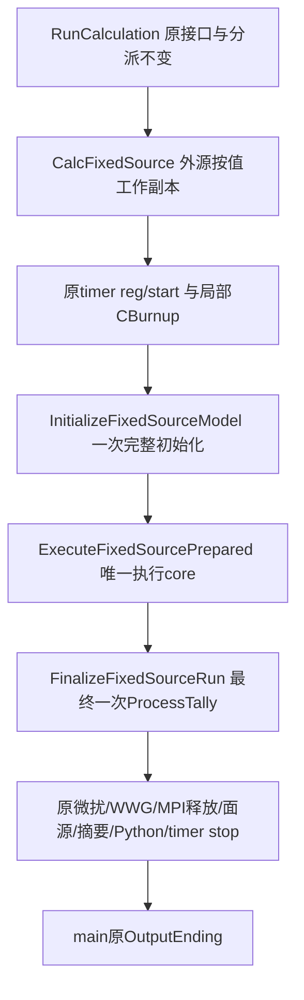

# F11阶段1实施方案（实施前方案原文；现已获批实施）

唯一设计基线：知识库04 §3.3/§5/§14。实际基线HEAD=c3ef093497ea42c54569a87ed3696642c8b42931。现有调用图/所有权/具体行号见source-map.md。

## 拟修改后的调用图



未来阶段2/后续F11可以复用I后，经正式Prepare再调用E→F；本阶段不增加该caller、不实现Prepare、不执行同进程重复计算，也不承诺再次直接调用E即可正常运行。

## 修改范围与机械移动

仅`RMC/src/CalMode.h`新增三个public成员声明/边界说明，`RMC/src/CalcFixedSource.cpp`定义同类成员并缩短普通wrapper。新方法放同一cpp，helper LoadBalanceTimeChecker/FinalizeLoadBalanceChecker保持原文件/原实现。`RunCalculation.cpp`、`FixedSource.h`及所有物理算法文件不修改；无新生产文件、无src/MLVR或Session/Controller/Manager。

| 原位置（当前HEAD） | 拟归属 | 操作 |
|---|---|---|
| 67–72 | 普通CalcFixedSource签名 | 原样保留，外源仍按值 |
| 73–76 | wrapper | timer注册/start、CBurnup构造原位置保留 |
| 77–95 | InitializeFixedSourceModel | 原有19行初始化/缓存/电子截面/计时登记原样移动 |
| 97–719 | ExecuteFixedSourcePrepared | 整块623行原样移动，last_t/TotalCount及MPI归约结束都保留 |
| 721 | FinalizeFixedSourceRun | ProcessTally唯一调用，wrapper只调用Finalize一次 |
| 722–750 | wrapper | 原全部可选功能、输出和stop按原序保留 |

“唯一core”是原六粒子模式分支整体仅有一份实现，不是删除分支或强行合并为一个粒子算法。本阶段不整理重复的bank代码、不修正既有break/哨兵规则、不改历史中的拼写PrcoessBatchEnd。

完整可审查的拟议补丁：`proposed-refactor.diff`。它未应用到RMC，**不是changes.diff生产完成证据**。`git apply --check`退出0；`logs/proposal-integrity.json`记录623行执行体hash且拟议文件中仅出现一次，初始化块/普通尾部保留，最终ProcessTally调用数为1。以上是静态/补丁适用检查，不是编译或数值验证。

## 具体C++签名

以下新增函数均为CDCalMode public成员，定义/声明的参数名与提案补丁一致。全部引用的是当前计算已有对象；不添加布尔状态组合或新所有权容器。

```cpp
void InitializeFixedSourceModel(
    CDCalMode &cCalMode, CDNeutronTransport &cNeutronTransport,
    CDPhotonTransport &cPhotonTransport, CDElectronTransport &cElectronTransport,
    CDAceData &CAceData, CDFixedSource &cFixedSource,
    CDMaterial &CMaterial, CDGeometry &CGeometry,
    CDParticleState &CParticleState, CDTally &CTally,
    CDBurnup &CBurnup, CDRNG &ORNG,
    CDSampling &cSampling, CDPerturbation &cPerturb);

void ExecuteFixedSourcePrepared(
    CDCalMode &cCalMode, CDNeutronTransport &cNeutronTransport,
    CDPhotonTransport &cPhotonTransport, CDElectronTransport &cElectronTransport,
    CDAceData &CAceData, CDFixedSource &cFixedSource,
    CDMaterial &CMaterial, CDGeometry &CGeometry,
    CDParticleState &CParticleState, CDTally &CTally,
    CDRNG &ORNG, CDCriticality &cCriticality,
    CDExternalSource &cExternalSource,
    CDSampling &cSampling, CDPerturbation &cPerturb);

void FinalizeFixedSourceRun(
    CDFixedSource &cFixedSource, CDMaterial &CMaterial,
    CDAceData &CAceData, CDTally &CTally);
```

普通CalcFixedSource的原15参数签名逐字保留（CalMode.h:223–227，包含`CDExternalSource cExternalSource`）。wrapper调用：

```cpp
// 原reg/start仍在此。
CDBurnup CBurnup; // 原寿命保留，不在Initialize内部临时构造
InitializeFixedSourceModel(cCalMode, cNeutronTransport, cPhotonTransport,
                           cElectronTransport, CAceData, cFixedSource, CMaterial,
                           CGeometry, CParticleState, CTally, CBurnup,
                           ORNG, cSampling, cPerturb);
ExecuteFixedSourcePrepared(cCalMode, cNeutronTransport, cPhotonTransport,
                           cElectronTransport, CAceData, cFixedSource, CMaterial,
                           CGeometry, CParticleState, CTally, ORNG, cCriticality,
                           cExternalSource, cSampling, cPerturb);
FinalizeFixedSourceRun(cFixedSource, CMaterial, CAceData, CTally);
// 原ordinary可选收尾与timer stop仍在此。
```

使用当前member this发起未限定调用，保留原core里`SampleFixSource(*this, ...)`的对象身份；不改为通过另一个cCalMode实例调度。source引用指向wrapper形参副本，不直接指向RunCalculation接收的源定义。模型、tally、particle、AceData初始化后不再复制，CBurnup直到普通计算返回仍活着。

## 三个函数的契约

- Initialize：普通完整初始化只执行一次，调用现有InitiateAll及原有粒子缓存/GenElectronCross。含模型、库、tally登记和一些单次状态准备，不拆解内部；它既不是每轮reset，也不保证幂等。
- Execute：调用者已经完成合法模型/物理角色/源/计数/bank/RNG/WW准备；相关timer仍在运行。stage1唯一合法生产caller是普通wrapper经Initialize后调用；stage2需正式Prepare后才能重用。core自身只持有局部last_t/TotalCount，不新增run状态。不得调用InitiateAll、ProcessTally、普通摘要、解释器关闭或MPI共享窗释放。
- Finalize：所有真实后代及负载平衡请求已结束，统计尚未最终处理；只调用现有ProcessTally一次。这里不增加reset、目标响应或文件交换，不关闭Output/WW全局资源。ordinary wrapper随后保持原输出次序。

## 风险与事前验证

| 风险 | 控制与反证 |
|---|---|
| source引用泄露 | 不改变普通外层按值签名；只引用该形参副本。对普通源库及面源读入进度检查外层对象不新增变化 |
| 初始化缩短对象寿命/重复登记 | CBurnup留wrapper；同一cTally owner在初始化后不复制；只初始化一次、registry大小/地址归属检查 |
| 随机序列或后代统计变动 | 623行执行体原样；相同固定N fresh过程，RNG/轨迹事件及Score/Sum1/Sum2/Ave/RE确定性对照，后代处理后再SumUpTally |
| final统计两次 | core无ProcessTally；wrapper一次Finalize；只在Finalize实现出现一次对应调用，GDB计数每进程最终调用1 |
| timer/FOM改变口径 | reg/start/interval/stop及OutputSummary位置均保持；实际墙钟值不要求相等，调用顺序和覆盖范围必须一致 |
| photon/电子/耦合丢失 | 六模式分支完整保留，现有P/E/PE/NPE CTest及NP代表用例逐分支运行；不能只编译neutron |
| MPI负载平衡/共享窗/Python可选功能 | 原宏代码和顺序不变；MPI/OMP编译检查；未跑的生产可选功能明确记录限制，不以serial通过冒充全覆盖 |
| 既有reference或核数据不一致 | baseline先于RMC改动，旧CTest原规则；任何baseline失败保留证据，不能更新reference或偷偷修复其它代码 |

测试与命令统一见test-plan.md。阶段0独立报告接受限定转换表；其中把Field/status/目标转换实现写到Stage1的建议，与当前任务及04 §14顺序不符，**不纳入本方案**。不改W11/W12或阶段0结果。

## 回滚

实施前保存两文件字节/hash（logs/CalcFixedSource.before.cpp、CalMode.before.h已有只读快照）。收到批准后再建立fresh baseline，产生实际`changes.diff`。若需要回滚，先确认RMC仍处于同一分支且没有他人后续修改，再对本任务补丁做`git apply -R --check`并仅反向应用本任务两文件补丁；核对原hash。发现新修改即停止协调，不reset/切分支/强制覆盖。不恢复/更新任何reference或数据库。

## 审批内容

待用户批准：只按以上两文件拆分、建立当前HEAD fresh-process baseline及规定回归、保留所有历史语义，完成后归档并停止；不做F11调度、Field/TARGET、CLEAR/SET/REBUILD或同进程重复运行。若审批前HEAD或工作树变化，先重新核查提案适用性与冲突。

## 实施记录

用户回复“批准，继续完成”后执行。两文件提案已原样应用，实际补丁见changes.diff；本文件上文保留审批时设计与风险，不把当时未执行的状态冒充当时已验收。最终验证与限制以README §4为准。
