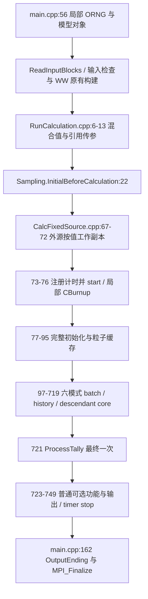

# 当前固定源结构、调用图与所有权（只读定位）

基线：RMC `c3ef093497ea42c54569a87ed3696642c8b42931`，分支`Neural_Network_WW_Iteration`。下面位置由本轮实际文件定位；原文见logs/source-evidence.txt。历史5cfb...关键结构在当前HEAD仍相同，不以历史binary替代新基线。

## 当前调用图

## 按职责划分

| 范围（当前行号） | 实际职责 | 重构安排 |
|---|---|---|
| `RunCalculation.cpp:6–13,22,83–89` | 本次模型工作副本、抽样前准备、普通固定源分派 | 完全不改签名/实现 |
| `CalcFixedSource.cpp:73–76` | FixedSource/Tally计时登记、start、构造CBurnup | 普通wrapper保留 |
| `CalcFixedSource.cpp:77–95` | 一次完整模型初始化以及缓存/光子电子准备 | 原样移至InitializeFixedSourceModel |
| `CalcFixedSource.cpp:97–105` | 每次执行的局部last_t、TotalCount、TIME_REDUCE设置 | 核心内部局部变量 |
| `CalcFixedSource.cpp:108–717` | 六种已有粒子模式的batch/history/真实后代处理 | 整体移动；不合并、删除或复制粒子分支 |
| `CalcFixedSource.cpp:719` | 等待未完成MPI负载平衡归约 | 仍属于执行完成，留在core末尾 |
| `CalcFixedSource.cpp:721` | Gather、CalcAveRe、统计诊断、部分反应率后处理 | FinalizeFixedSourceRun唯一调用ProcessTally |
| `CalcFixedSource.cpp:723–749` | 微扰输出、WWG、MPI共享窗释放、面源输出、摘要、Python关闭、timer stop | 普通wrapper保留原顺序 |

### 完整初始化不是每轮准备

`InitiateAll.cpp:125–210`：设伴随标志→`InitiateMatAce`→微扰/光子XS/TMS/截止→`InitiateTrspt`→`InitiateTally`→接续读取并恢复RNG位置→几何/粒子临时缓存→history统计标志→裂变多重性/材料分数→WWG及MCNP-WW初始化→群截止转换→Python源解释器初始化。

材料及MGACE加载在`InitiateMatAce.cpp:8–29`，伴随派生处理在63–66。tally definition→数组分配/统计清零/指针登记在`InitiateTally.cpp:8–149`；登记`push_back`在57、69、93、104、115、135。重复调用完整初始化可能重新读库、重复登记、重处理模型/群截止，不等价于reset。**阶段1不拆解这些成熟初始化内部。**

`InitiateTrspt.cpp:60–101`只清/分配部分fixed-source计数和旧源库，不包含构造函数里的finish、current batch、多个particle bank等完整状态；不能拿它当正式Prepare。

### 每次执行中的准备与结束

- `CheckTransport.cpp:51–72`的`CheckFixedSource`在输入检查阶段设置N与接续/时间间隔；不是core入口自动执行的reset。
- `InitialBatchSource.cpp:30–38`的DistributeSource每batch增加currentBatch、再分发普通/面源与RNG位置。
- 各模式在CalcFixedSource的106、210、293、430、503、601行进入分支。Neutron/Photon/NP/PE/NPE按现有规则push哨兵；Electron分支保留现状。后代粒子栈真实完成后再SumUpTally，原WWG残余库清理顺序不变。
- `ORNG.GetRandSeed`在119、223、307、442、516、615；由main局部ORNG经引用传下来的实际对象执行。全局同名ORNG(`main.cpp:37`)不是本链RNG owner。
- `PrcoessBatchEnd`实现`InitialBatchSource.cpp:199–345`（拼写按真实代码保留）：MPI汇总、面源逐batch输出、完成数/下一间隔、普通或面源归一化、自发裂变多重性修正、cell统计分母、接续写出。不能移到只执行一次的Finalize。
- `ProcessTally.cpp:330–441`最终gather/诊断/均值，364–365使用M=p_dTotStartWgt、Div=1。**本阶段不解释或修改非单位源归一规则，不改W11/W12。**

## 对象所有权和传递边界

| 对象 | 真实工作对象与生命周期 |
|---|---|
| `CDCalMode` | member函数原this不变；保留显式cCalMode引用，辅助方法通过同一个this调用，不改为cCalMode实例分派 |
| NeutronTransport、Geometry、Criticality、Material、ParticleState、Convergence、Tally、Burnup、Sampling | RunCalculation按值参数形成工作对象，地址有效到其返回；固定源子函数沿用引用，不在初始化后再次复制这些对象 |
| PhotonTransport、ElectronTransport、AceData、FixedSource、ORNG、Adjoint、ExternalSource等 | RunCalculation对应参数为引用（完整签名在源码），与main对象关联 |
| `cExternalSource` | RunCalculation接收引用，但CalcFixedSource再按值形成局部工作副本。core新引用指向这个副本；它的源库清空、面源读入进度等局部改动保持原隔离。没有引入新的深拷贝契约，也没有修改已有内部共享资源语义 |
| `CBurnup` | CalcFixedSource:76本地构造，持续至wrapper返回；Initialize接收引用，绝不在helper内缩短其寿命 |
| tally registry | 由实际cTally成员数组构成、自身保存成员地址；初始化后不复制其owner，不重复InitiateTally注册 |
| 粒子缓存 | ParticleState承载核素缓存、光子XS、几何位移、伴随/微扰暂态；refs跨helper调用有效，不能盲目浅拷贝 |
| global `OWeightWindow` | main.cpp:31进程级实例；native三界由ReadWeightWindow.cpp:424→WeightWindows.cpp:79–101构建。MCNP/WWG部分在InitiateAll中初始化；普通MPI_Win_free仍留wrapper，core不销毁其资源 |
| global `OTimer` / `Output` | 进程级；Timer.reg使用map.emplace而非reset（Timer.h:123–126），start/interval/stop有状态。完整普通计时保持wrapper覆盖初始化到摘要/Python收尾；OutputEnding仍在main |

## 阶段2仍缺什么

FixedSource的完成/批次/计数、bank与哨兵、面源/自发裂变状态；ExternalSource工作源库/进度；tally Score/ScoreTemp/Sum1/Sum2/Ave/RE/高阶诊断及索引集合（保留registry）；AceData正反角色、伴随派生量及物理群截止；ParticleState几何/核素XS/微扰/伴随缓存；RNG有效段和static跳跃参数一致性；WW三界与状态；Timer逐次计时和Output逐次文件生命周期。**只列owner与风险，不实现CLEAR/SET/REBUILD，不声明repeated-run Ready。**

## 实施后的工作树位置（HEAD c3ef0934 + changes.diff）

仅两个批准文件有差异，未提交。CalcFixedSource.cpp:67为原入口，73–83保留timer/CBurnup并调三个成员；114为InitializeFixedSourceModel、141为ExecuteFixedSourcePrepared、772为FinalizeFixedSourceRun，774唯一ProcessTally调用。旧97–719行执行体原样位于新147–769（623行），没有第二份suite；CalMode.h:230/238/246声明对应方法。原source-map表格记录的是HEAD原文，实施工作树位置以本节及实际补丁为准。

普通路径仍为wrapper计时/局部源副本→一次初始化→唯一core→最终统计→原可选输出/收尾。独立fresh-process回归与只读诊断见README §4，正式reset清单不变，未执行同进程重复调用。
