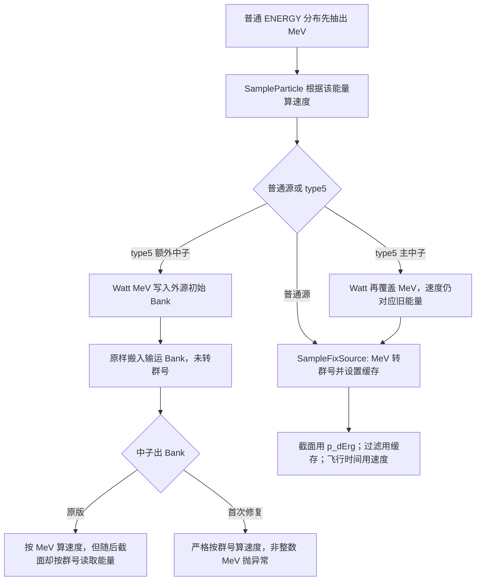

# W14 能量表示与粒子状态审查：源码与有限动态核对表

日期：2026-10-17。源码：`Neural_Network_WW_Iteration / b6f49808153c73d8744ac8cfd7d5728f926dc194`，工作树干净。原始对照：`4810694b7a99dfc3ad7d27f7d443814f511f4829`。第一次修复已提交，8文件内容与修复档案一致，见[身份记录](logs/baseline.json)。

**状态：G1–G4已确认，有限验证与审查归档已完成；未实施修复。** 数值结果与观察限度见[REPORT.md](REPORT.md)，下表仍把未实跑分支单列。 以下行号均为当前HEAD；函数名用于后续行号漂移时定位。路径相对 `RMC/src/`。不把“源码分支存在”写成“已有模型运行通过”。

证据标签：**SOURCE VERIFIED**＝当前源码及调用者已核对；**INFERRED**＝依赖输入、运行可达性或数据的推断；**UNVERIFIED**＝尚缺对应验证。表中 VERIFIED CORRECT 仅指注明的表示/更新关系，不授予整个功能正确性；历史动态结果单独注明，不计为本轮新实验。

## 1. 先分清三个数，以及真正使用它们的地方

`p_dErg` 是复用字段：普通外源抽样阶段为物理动能MeV；进入MG中子/光子输运后为用double保存的整数群号g；CE输运一直为MeV。MG内部1为最高能群、G为最低能群，群中心数组从低到高，因此中心索引为 `G-g`。

`p_nMultiGrpNumber` 是另外保存的群号缓存。`ErgGrp()`（`ParticleState.h:1357`）实际读取并四舍五入 `p_dErg`，并不读取该缓存，更不是按能量边界查群。`p_dVel` 是cm/shake，必须对应当前输运粒子；中子MG使用群中心速度，光子使用c，电子不能套用中子质量或MG群表。

| 消费者 | 实际调用/位置 | 期待的数值 | 当前核对结果 |
|---|---|---|---|
| MeV→群号 | `GetMgCs.cpp:263` `LocateMgErgGrp` | 物理MeV＋粒子类型 | n/γ分别使用自己的边界；电子不支持。不能给已有群号再调用一次 |
| 中子速度 | `GlobeFun.h:531,540` `GetNeuVel / GetNeuVelMg` | 前者MeV；后者整数g | 当前MG helper检查有限性、整数性、1..G、数组大小和中心；不应撤掉检查使Watt继续运行 |
| MG中子自由程/碰撞截面 | `SampleFreeFlyDist.cpp:47,65–79` → `ErgGrp()` → `GetMgNeuNuc*Cs` | g | 正常g正确；若MeV进入此处，会被当群号取整，可能错误截面/非法索引，已超出速度问题 |
| MG光子截面 | `SampleGmaFreeFlyDist.cpp:55–58` → `GetPhotonAtomCs.cpp:24,31–35` | g | `int(dEg0)`直接索引MG表；恒定光速不会保护错误能群 |
| Mesh通量与能量bin | `ScoreMeshTally.cpp:89` → `GetErgValue` | 状态g→中心MeV | 正常表示下转换正确；输入非法g的安全性仍依赖上游 |
| Cell/Surface/Point能量乘子 | `TallyCellByTL.cpp:122–134,162`；`TallyAtSurface.cpp:136–168`；`TallyAtPoint.cpp:177–215` → `CalcMultiplier.cpp:85,91` | 先转中心MeV，再算1/v或能量乘子 | 不能仅看到`GetNeuVel(dErg)`就判错：这三条调用已转换为MeV |
| native WW | `WeightWindows.cpp:85–99` `GetWeightWindowEnergy` | g→中心MeV | Stage2路径有转换；MCNP-WW分支88直接返回rawEnergy，属于不同合同，未在本轮验证 |
| 群过滤及PTRAC | `Filter.cpp:73–80`；`ParticleTrack.cpp:343,363` | `p_nMultiGrpNumber` | Bank或光子碰撞后缓存不同步可能改变过滤/输出；不能用截面读取p_dErg来证明过滤正确 |
| 飞行时间 | `TrackWithWeightWindow.cpp:34–37` → `ParticleStateFun.cpp:143–154` | Δt=L/v | 空间位移不使用v；时间直接使用v。时间截断还读取v（同文件302起） |
| 临界准静态时间吸收 | `RayTracking.cpp:40–43`、`TrackHistory.cpp:76–78` → `CalcNeuVel.cpp:24` | g先经`GetErgValue`转MeV | 此局部速度转换正确，不能与错误的`p_dVel`字段等同 |
| 其他时间/能量消费者 | `ScoreNeuLifeTime.cpp:19–35`；`Filter.cpp:65–66`；`ReadPhysicsBlock.cpp:76,211` → `TrackHistory.cpp:39,327`/`TrackGmaHistory.cpp:30,63` | 随功能合同而定 | GPT寿命一支直接将raw energy给CE速度；另一支用`XSS[g]`。非默认截止值、ERGFILTER也直接比较raw字段。MG可达性/输入单位及影响需补查，暂为POTENTIAL RISK，不能宣布均已验证 |

`GetErgValue`和群中心访问（`GetMgCs.cpp:231–259`）没有当前速度helper的完整边界检查。因此修好一个速度函数，并不能保证所有能量使用端安全。

## 2. 全路径表：按实际生产者和恢复边界分组

| 能量来源/路径 | 函数及当前行号 | 最终能量何时确定/是否覆盖 | Bank格式 | 状态判断与证据界限 |
|---|---|---|---|---|
| 普通固定能源、离散谱 | `SampleParticle.cpp:27,76–87`；`SampleNeutronSource.cpp:269–280` | 抽样结束后写MeV；MG速度临时查g；稍后正式写g | 主粒子无初始Bank | **VERIFIED CORRECT**：当前ordinary固定源的表示/速度关系；SOURCE VERIFIED＋本轮E3：低/中/高与离散F/A映射、v、首飞通过 |
| 普通Maxwell、Watt、Evaporation | `SampleValue.cpp:271–292` → `SampleEnergySpectrum.cpp:6,19,27` → `SampleVariableFromDistri.cpp:101–104` → `SampleParticle.cpp:76–87` | **在算速度之前**产生MeV，没有type5那次后覆盖 | 同上 | **VERIFIED CORRECT（E3，限定所测参数）**；Maxwell F/A、普通Watt/Evaporation F实际抽样、映射及首飞通过，不能与type5 Watt混同 |
| Gaussian谱 | `SampleValue.cpp:295–305`；`SampleEnergySpectrum.cpp:35–66` | 同样先抽样MeV再算速度 | 同上 | **VERIFIED CORRECT（E3，限定所测参数）**；Gaussian F实际抽样、映射及首飞通过；不验证负能尾或任意参数 |
| bin/分段线性/幂/指数/子分布 | `SampleValue.cpp:11–269`；`Source.cpp:18–63` | 都先写`p_dEnergy`；没有群号运算 | 同上 | **VERIFIED CORRECT（表示传递）**；不验证各分布概率公式 |
| 依赖ENERGY分布 | `SampleVariableFromDistri.cpp:220–223`；`SampleValue.cpp:420–447` | 子分布/离散/bin产生MeV，在速度前完成；其它从属类型会报不支持 | 同上 | **VERIFIED CORRECT（静态时序）**，运行未验证 |
| type5 Watt主中子 | `ExternalSource.cpp:58–59,364–445,450–539`，关键483→499 | 普通源算v(E0)后，Watt覆盖为E1；`SampleFixSource:270`再写g(E1)，没有重算v | 主粒子 | **CONFIRMED BUG**：SOURCE VERIFIED＋本轮MG/CE动态E3；最终能量已变，首飞仍用旧v |
| type5 Watt额外中子 | `ExternalSource.cpp:506–530` → `CalcFixedSource.cpp:186–198,364–376` → `SaveSplitParticles.cpp:51–66` → `SampleNeutronSource.cpp:310–321` | Watt最终MeV原样转入输运Bank | **MeV误入MG群号Bank** | **CONFIRMED BUG**：本轮当前版SIGABRT；原版1.06945 MeV误作g=1，实际σ=5.97990005而正确g=12应6.837449；已证明错误截面 |
| CGMF/FREYA等特殊外源 | `ExternalSource.cpp:66–343`：主中子97/183/265；额外中子119/205/287；光子150/236/318 | 外部事件能量覆盖；普通源速度未随主中子覆写更新 | 外源初始n/γ均为事件能量，转Bank未显式查群 | **POTENTIAL RISK**：与type5结构相同；需要特殊宏/库，未动态验证，不凭函数名授予正确性 |
| Python源 | `PythonInterface/PythonInterface.cpp:140–160` → `SampleFixSource` | Python返回MeV，第一次修复局部查g；后续转换 | 主粒子 | **VERIFIED CORRECT（该静态入口）**；宏开启完整运行未验证。直接C API写能量另行列风险，不混成此入口 |
| native WW/几何重要性split | `SaveSplitParticles.cpp:25–45` → `SampleNeutronSource.cpp:287–369` | 复制已有输运g，不再抽能量 | MG:g；CE:MeV | 当前中子**速度VERIFIED CORRECT（E3）**；**CONFIRMED BUG**：F/A各31次Pop中22次缓存不同步；n/γ共用 |
| 固定源普通诱发裂变瞬发后代 | `GetFissionNeuState.cpp:723–736` → `GetMgExitErgMu.cpp:325–368` → Pop | MG直接抽整数g；CE抽MeV；伴随保留已抽伴随g（727） | MG:g；CE:MeV | 当前标准MG **速度/首飞VERIFIED CORRECT（E3）**：Forward3个真实后代g=12/15/9；缓存3/3旧值。非零裂变Adjoint资格化未做 |
| CE缓发/各种反应律谱 | `GetFissionNeuState.cpp:669–719`；`GetExitState.cpp:101–117`；`ReactByLaws.cpp:60–174`等 | Maxwell/Law7、Evaporation/Law5/9、Watt/Law11等产出MeV，再经CE状态更新或Bank恢复算v | CE:MeV | **VERIFIED CORRECT（表示关系）**；未逐law动态验证，不能据外源同名谱验证这些law |
| MG缓发后代/动力学Bank | `GetTotNu.cpp:92–117`；`GetFissionNeuState.cpp:877–930`；`BankNeuSource.cpp:7–61,137–163`；`SampleNeutronSource.cpp:603,684,764,899,1133` | 标准MG专用瞬/缓发分支直接抽g，保存到中子/先驱核Bank；出库按MG/CE算v但无缓存同步 | 按生产者为g或MeV | **POTENTIAL RISK**：MG专用链表示可追踪；CE缓发law分支是否可能被MG数据启用取决于JXS[24]/数据，未动态验证 |
| 动力学外源/自发源 | `SampleNeutronSource.cpp:1076–1120` → `846–884` → `603–621` | ExternalSource返回MeV，未转换就保存，MG恢复期待g | MeV误入MG中子Bank | **POTENTIAL RISK**：SOURCE VERIFIED的数据流缺口；相应KINETICS输入尚未实际运行 |
| 普通固定源中子碰撞 | `GetExitState.cpp`固定源重载 → `TrackHistory.cpp:275–292` | MG出射g；CE出射MeV；分别更新v，MG同时更新缓存 | 如产后代，沿上述Bank | **VERIFIED CORRECT（E3，所测固定源碰撞更新）**；MG/CE分别更新，当前正常后代动态支持 |
| 临界中子初始/裂变Bank及碰撞 | `InitialSource.cpp:36–49`；`SampleNeutronSource.cpp:18–177`；`RunHistory.cpp:72–86`；`GetExitState.cpp:27–37`；`TrackHistory.cpp:149` | 初始MG直接g=1，Bank恢复能量未更新v；碰撞MG出g后却调用CE `UpdateNeuState` | MG:g；CE:MeV；外源例外 | **CONFIRMED BUG（E3）**：普通临界初始Bank g=1/v=0→首飞Inf；碰撞g=13按13 MeV算v且缓存旧。外源首代MeV未转换仍为POTENTIAL RISK，未动态覆盖 |
| UFS/Wielandt/假粒子/MPI域恢复 | `UFS.cpp:30`；`WldtSampleSource.cpp:17`；`AdProcessPseudoPar.cpp:28,70`；`DomainDecomposition.cpp:384–421`；`GPT_AnalogProcess.cpp:222` | 恢复raw能量，未见统一v/cache更新；部分后续调用CE更新 | 来自输运时的表示 | **POTENTIAL RISK**；各功能门禁/特殊模式动态UNVERIFIED，不能从普通固定源外推 |
| RMC写出再读取的接续面源 | `WrtTrc.cpp:88,94` → `GetSurfTrcs.cpp:167,225,237` → `SampleFixSource:270` | 文件写raw能量；MG写g、读主粒子后又按MeV查群；读主粒子不设置v | 文件/分裂Bank为写出时raw表示 | **POTENTIAL RISK**：同MG接续有重复转换证据；CE接续主速度也未重建。需真实write/read用例确认，不猜外部面源文件单位 |
| 普通光子源/固定源光子Bank | `SampleParticle.cpp:92–94`；`SampleFixSource:269–280`；`Pop:322–323` | 主源MeV→MG光子g；v=c；Bank本应保存光子g | MG:g；CE:MeV | 速度/主源转换 **VERIFIED CORRECT（E3）**；F/A、CE和n→γ Bank通过v/首飞；MG Bank缓存仍旧 |
| 固定源MG中子产光子、伴随光子产中子 | `ProcessNeuGma.cpp:128–139` → `GetMgExitErgMu.cpp:288–318`；后者518–596 → `TrackGmaHistory.cpp:145–150` | MG直接抽目标粒子群号；伴随产中子时杀死原光子596，未让中子g继续作活光子输运 | 目标粒子的g | **VERIFIED CORRECT（表示关系）**；本轮n→γ目标群/光速通过，缓存恢复不完整；Aγ→n动态未覆盖 |
| MG光子碰撞 | `ProcessMgPhotonCollision.cpp:13–66` → `TrackGmaHistory.cpp:124–130` | 出射为g，覆盖p_dErg；v=c不需按能量重算 | 可能为目标粒子g | **CONFIRMED BUG（E3）**：F/A变群缓存未同步；实际PTRAC GRP=8误拒g=8/cache=11。所测XS按p_dErg正确取表 |
| CE光子散射/产次级粒子 | `TrackGmaHistory.cpp:91–106`；`ProcessComptSact.cpp:122`；`ProcessPhotonuclear.cpp:93,136`；`ParticleStateFun.cpp:82–115` | CE路径产MeV；中子/光子用固定源Bank出库重建相应速度 | CE:MeV | **VERIFIED CORRECT（表示关系）**；这些CE反应函数不应直接拿MG群号使用，未逐反应动态覆盖 |
| 临界耦合光子Bank | `CalcCriticality.cpp:143–154` → `SampleNeutronSource.cpp:434–535` → `TrackGmaHistory`/`GmaGeoTracking:82` | 恢复光子能量和类型，没把v改为c；同一个粒子状态刚跑完中子 | 来自中子/电子产生的光子能量 | **POTENTIAL RISK（E1恢复缺口）**，首飞实际v与时间未动态验证；并非MeV/群号换错这一种原因 |
| CE电子/正电子外源 | `SampleParticle.cpp:76–99`；`ParticleState.h:468`；`CalcFixedSource.cpp:495–524,609–615` | 始终MeV；switch无电子速度赋值，fresh状态v初值0 | 主粒子 | **CONFIRMED BUG（E3）**：14 MeV电子源v=0，首飞时间Inf；动能始终MeV，并非群号错配 |
| CE电子/正电子后代及电子WW | `PhotonProduceElect.cpp:48,94,124`；`BankSecondaryElectron.cpp:25,52`；`SampleNeutronSource.cpp:373–395,538–562`；`TrackElctronHistory.cpp:87,130,279,424` | MeV损失/抽样；独立`p_nHighErgIndex`用于插值，不把E换成群号；出库v固定c | CE:MeV | **POTENTIAL RISK（近似适用性）**：CE光子产电子真实后代已观察v=c（E3）；其能量仍MeV。真实速度不同，沿程时间近似精度未验收，不由此推断空间能损错 |

未逐项动态资格化：AIS、CGMF/FREYA、Python子程序、MPI域分解、GPT/复杂临界加速、外部接续文件、任意MG＋电子/光核混搭。MG能量定位只支持n/γ（`GetMgCs.cpp:301–304`），电子能量网格索引不是MG群号。上述表没有把不支持配置当作应运行成功的测试。

## 3. 核心因果链与原始/首次修复差别

1. 原始普通源的 `GetNeuVelMg(MeV)` 是第一次错配；首次修复改为局部查g，只修好**速度之后不再改能量**的源。Maxwell等正常分布属于这种顺序，不能与type5一概处理。
2. type5的主中子最后能群可正确，但速度还对应旧能量；额外中子的MG能群本身也不正确。原版Bank按CE算v不抛异常，**不意味着后续MG截面拿到了正确群号**。首次修复的严格检查揭露了Bank合同本来不统一。
3. 旧MeV若恰好是1..G整数，严格速度检查也识别不了“伪装成合法g的MeV”。因此不能只靠越界检查修复，必须在生产者→消费者边界明确表示。
4. WW/诱发裂变已有g，**绝不能为了修type5而在所有Pop里统一LocateMgErgGrp**；那会把正确g再当MeV转换。缓存不同步是另一条消费者问题：截面正确不代表群过滤正确。
5. photon v=c不依赖能量，不会直接触发中子速度helper错误，但有群缓存、特殊外源Bank、临界耦合恢复问题。电子走CE动能/阻止本领网格，存在独立速度缺口，不能称为中子MG问题的同一实例。

以上首次修复以外的现象来自当前调用链；8文件diff未引入光子碰撞、电子初始化、临界碰撞等旧缺口。本轮已确认type5错误截面、旧缓存误筛PTRAC和非法飞行时间；不能据此整体否定已有稳态Tally或F02/F03结果。

## 4. 统一修复设计：不改抽样概率和调度（待另行批准）

**尚未获实施批准。** 最小方向是明确两个入口，优先放在现有粒子状态/源类：①“最终物理MeV进入输运”只转换一次；②“已有输运能量恢复状态”不转换，只校验并重建v/cache。不要用数值大小猜表示，也不要撤掉严格检查或clamp掩盖错误。

| 边界 | 设计要求 | 预计涉及的已有文件/函数 |
|---|---|---|
| 普通/type5/Python主外源 | ExternalSource各抽样步骤保留MeV；所有后覆盖完成后，在进入输运前按粒子类型转换并重算v/cache；不新增随机抽样 | `SampleNeutronSource.cpp::SampleFixSource`；可在`ParticleState.h/ParticleStateFun.cpp`加极少量明确语义辅助接口 |
| 外源初始n/γ Bank→输运Bank | 外源初始Bank明确为MeV；搬运时按**目标粒子类型**转g；CE原样。不要使ExternalSource提前写g后又被SampleFixSource转换 | `CalcFixedSource.cpp`两处n转移及γ转移，复用少量辅助代码；`ExternalSource.h`合同注释 |
| WW/诱发裂变/输运Bank Pop | MG输入已是g；验证g范围、重建v并同步缓存；CE继续MeV；保持历史、权重、RNG、栈次数和调度 | `SampleNeutronSource.cpp::PopParticleOutofStack`；不改`SaveSplitParticles`物理算法 |
| MG碰撞结果 | 存活粒子出射g写入后同步缓存；中子用MG速度，光子恒c；伴随产不同粒子时按目标类型恢复 | `ParticleStateFun.cpp::UpdateNeuStateMg`、`TrackGmaHistory.cpp::TreatMgPhotonReaction`；普通固定源现有正确中子更新直接复用 |
| 临界/动力学/接续等扩展入口 | 复用上述明确边界；临界外源MeV与裂变Bank g分开；接续文件必须识别写出时表示，禁止一概查群 | `SampleNeutronSource.cpp`相应入口、`TrackHistory.cpp`临界更新、`GetSurfTrcs.cpp`；特殊模式待动态判定后确定最小改动，不承诺一次纳入全部 |
| 电子及其它时间计算 | 不将电子送入中子helper；真实速度是否在减速过程更新、是否保留既有时间近似需独立确定，不能假称v=c物理精确 | `SampleParticle.cpp`、电子Bank/输运相关函数；列为单独修复项候选，当前不实施、不默认扩展W14第二轮补丁 |

实现前必须收口两个边界：接续面源的文件表示/兼容范围；电子时间模型的合同。它们不阻碍先验证已明确的type5/普通谱/Bank链，但阻止宣称“一份固定源补丁已经修好所有计算模式”。测试与验伪条件见[test-plan.md](test-plan.md)。

拟采用的两个辅助接口语义（名称待实施审批，非现有API）：`SetFromPhysicalEnergy(CDAceData&, eParticleType, double mev)`与`RestoreTransportEnergy(CDAceData&, eParticleType, double energy)`，放在既有`CDParticleState`。前者转换后调用后者；后者MG仅接受已是g的数值，重建v/cache。不能增加“是否已转换”布尔标志或按数值猜单位。电子若不纳入当次修复，就必须显式限定这两个接口只覆盖n/γ，不能保留无说明的默认分支。

下一次最小核心修复候选文件为`ParticleState.h`、`ParticleStateFun.cpp`、`SampleNeutronSource.cpp`、`CalcFixedSource.cpp`、`TrackGmaHistory.cpp`、`TrackHistory.cpp`以及`ExternalSource.h`的合同注释；`SampleParticle.cpp`/Python源中既有临时速度计算是否可删须先确认所有调用者，不能为了“集中”而破坏尚未迁移的临界/动力学入口。`GetNeuVelMg`现有严格校验继续保留。临界修复可复用同一状态更新，但与固定源的回归单独验收；电子/接续/动力学等需要另列文件和边界后再批准，不在此暗含生产授权。
